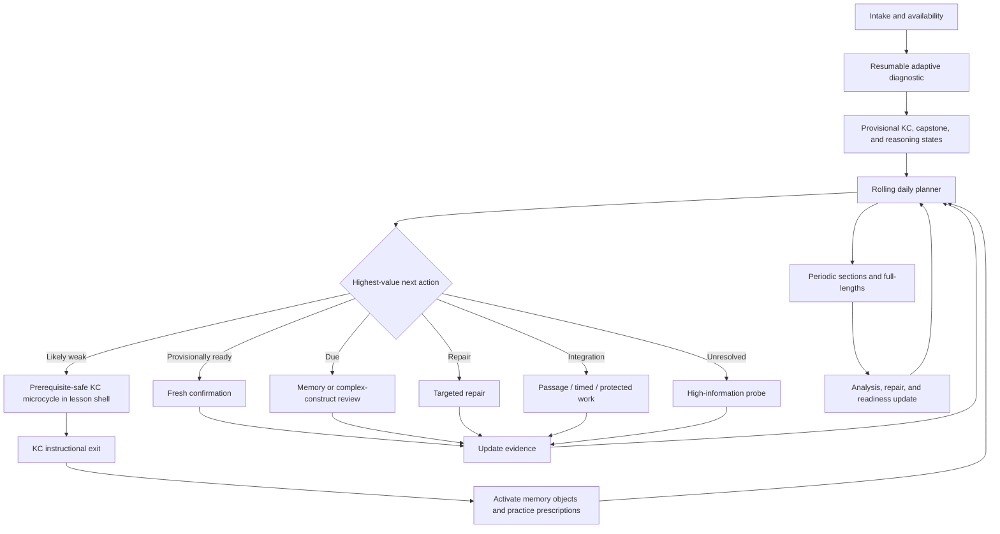

# MCAT App Complete Learning Flow

## Canonical product, instruction, adaptive-planning, review, and readiness specification

**Status:** Design specification, version 0.2  
**Date:** July 22, 2026  
**Audience:** Product, curriculum, psychometrics, learning science, content, design, and engineering  
**Scope:** The complete learner flow from intake and diagnostic through daily lessons, review, CARS, integrated practice, full-lengths, and exam preparation  
**Implementation status:** This document describes the target system. It does not imply that the current application already implements or validates the complete flow.

---

## 0. How to read this document

This is the unified specification for the learning system. It combines:

1. The end-to-end learner experience and simple, prescriptive product flow.
2. The V3 curriculum architecture of stable lesson shells, nested knowledge components, capstones, and typed pathways.
3. The KC-specific instructional-microcycle and lesson-generation method.
4. The daily planning, capacity, review-debt, and missed-day model.
5. The separation of exact-memory scheduling from broad construct evidence.
6. The science-passage, CARS, timed-practice, and full-length progression.
7. The measurement, content-governance, safety, and validation requirements.

It is intentionally more precise than a wireframe and less implementation-specific than an engineering design document.

Normative words have the following meanings:

- **MUST:** required for scientific, psychometric, instructional, security, or learner-safety integrity.
- **SHOULD:** the default product behavior unless evidence justifies an exception.
- **MAY:** optional behavior that does not weaken required evidence or safety boundaries.

Exact numerical thresholds in this document are initial product policies to pilot. They are not universal laws of learning.

### 0.1 V3 curriculum authority boundary

Curriculum identity, ownership, graph semantics, placement, revisits, and remediation coordinates MUST derive from the pinned V3 authoritative registry:

- Registry: `curriculum-architecture-v3/work/v3-authoritative-registry.json`
- Registry SHA-256: `635c39e9c0ebb28a3892399449aa9b74893aae3264924cd739b92b6e370ba26a`
- Inventory: 114 canonical lesson shells, 422 canonical knowledge components (KCs), 114 groupings, 53 extensions, 43 capstones, 11 host-attached support artifacts, 272 source occurrences, and 1,604 atomic source mappings
- Graph: 634 authoritative edges, including 143 hard prerequisites; only hard edges may block their recorded point of use
- Sequence: five phases, 40 modules, seven pathway overlays, 114 first-delivery lesson relations, 42 required capstone placements, 114 upgraded revisits, and 504 exact repair/reentry relations

The registry is the single source of curriculum truth. Public JSON, CSV, Markdown, indexes, and Canvas explorers are generated views and MUST NOT be maintained as independent state. Runtime ingestion MUST pin the registry hash and accepted freeze identifiers, use package-relative locations, and ignore stale author-machine paths or historical workflow labels.

V3 is complete only against the supplied 2020 AAMC source ceiling. Present-day AAMC authority has not been refreshed; the architecture remains learner-unvalidated; page-89 stem-cell/CNS-regeneration material remains held and nonrequired; and V3 supplies no finished lesson prose, assessment bank, rubric, calibrated mastery threshold, or efficacy claim. Product-authored instruction and assessment are separate, versioned, reviewed layers.

---

## 1. Executive summary

The app is not a content library and not merely a spaced-repetition system. It is a continuous decision system that:

1. Loads the pinned V3 curriculum and preserves its authority boundary.
2. Estimates what the learner can currently do and how uncertain that estimate is.
3. Selects the most valuable feasible work for today.
4. Delivers one KC-specific instructional microcycle at a time inside a coherent lesson shell.
5. Fades support until the learner can use the KC without lesson help.
6. Separately tests independent use, transfer, retention, passage integration, timing, and protected performance.
7. Investigates failures without pretending a distractor proves their cause.
8. Repairs weaknesses and verifies those repairs on fresh tasks after delay.
9. Schedules exact memories using FSRS and complex constructs using a separate evidence model.
10. Maintains a recurring, passage-first CARS strand.
11. Incorporates timed sections and full-lengths progressively.
12. Replans after every session, missed day, capacity change, or major new result.

The learner sees a simple interface: one recommended next action, a short plan preview, and deeper reasoning available on demand. Underneath that simplicity are distinct diagnostic, instructional, memory, mastery, planning, and readiness systems.

The central evidence boundary is:

> Diagnostic performance is provisional. KC instructional exit means initial instruction for that KC is complete. Lesson delivery completion means all required nested KC microcycles have exited; neither is mastery. KC and capstone mastery require fresh downstream evidence, and exam readiness requires representative timed evidence.

A target such as 520 is an aspiration and planning input. It is not a guarantee or a value the internal mastery map can directly produce.

---

## 2. Locked product decisions

### 2.1 Canonical V3 hierarchy: KC instruction inside lesson shells

The curriculum MUST preserve the 114 canonical `V3-LES-*` lesson shells and their 422 ordered `V3-KC-*` claims.

- Every KC belongs to exactly one owning lesson.
- Every lesson contains one to five KC-specific instructional microcycles ordered by its canonical grouping contract.
- The lesson shell supplies the coherent throughline, navigation, checkpoints, and reteach context; it has delivery state but no mastery state.
- Diagnosis, assistance routing, instructional exit, evidence, freshness, and repair are recorded per KC.
- The runtime MUST NOT add, remove, merge, split, or rehome KCs. Boundary changes require a governed registry revision.
- A repair branch returns to the exact failed KC microcycle and checkpoint. A predecessor KC in another shell routes through that KC’s owning lesson.
- Extensions remain bounded application, context, or representation deltas. Capstones remain separately measured coordination claims. Supports remain nonstandalone host-attached routes.

### 2.2 Teach, fade, then test separately

Novices receive explicit models and worked examples. Assistance fades based on performance. Unsupported KC-exit checks may end initial instruction for that KC but MUST NOT be presented as durable mastery.

### 2.3 Personalization remains revisable

The app MUST treat diagnoses, error causes, mastery states, and readiness estimates as revisable beliefs.

- A distractor is evidence about a selected answer, not proof of an internal misconception.
- A provisionally ready KC or construct can later become uncertain or require refresh.
- A previously weak KC or construct can improve without being permanently labeled.

### 2.4 Personalize support; do not bypass required V3 scope

Diagnostic evidence MAY select concise, standard, misconception, or prerequisite-support delivery for an individual KC. It MUST NOT omit a required KC microcycle while V3 adaptive bypass remains unauthorized.

Prepared learners MAY bypass a conditional below-ceiling support artifact when its routing condition is absent. This is support personalization, not omission of required KC scope.

Every missing, stale, uncertain, or invalid bypass condition fails closed to instruction. Future bypass activation requires calibrated assessment packs, recency and uncertainty rules, false-skip controls, failure handling, exact repair/reentry, subgroup evidence, and independent governance approval that releases `V3-HOLD-110009`.

### 2.5 Simple by default, transparent on demand

Home SHOULD emphasize one “Start today’s plan” action. The learner MAY inspect:

- Why each task was selected.
- What was deferred.
- Coverage and uncertainty.
- Review debt.
- Error and repair history.
- Workload feasibility.
- Readiness evidence and its limitations.

### 2.6 The planner may assign zero new KC microcycles

Review, repair, CARS, passages, timed work, full-length analysis, or recovery may be more valuable than new acquisition on a given day.

### 2.7 CARS uses a phase-adaptive hybrid

CARS is passage-first overall, with a meaningful but bounded Duel role:

- During early V3 phases, ordinarily one guided CARS contact per week MAY be Duel-led when the learner needs explicit argument support. A second guided passage is permitted only when representative work still remains the clear majority of unique testlets and CARS study time.
- Representative A0 passage multiple-choice testlets remain the majority of both unique CARS testlets and CARS study time.
- A coached Duel passage and its same-passage MCQ cap are instructional; they do not satisfy representative-passage quotas or create independent evidence.
- Duel frequency fades as independence and exam specificity increase.
- Duel output is formative and contextual; it MUST NOT award mastery or predict a score.

### 2.8 Readiness and curriculum completion remain separate

The app MUST distinguish:

- **Curriculum status:** what has been introduced and demonstrated across evidence modes.
- **Exam readiness:** recent representative timed performance under comparable conditions.

---

## 3. Canonical terminology and identifiers

The word “skill” is often overloaded. The system SHOULD use explicit identifiers.

### 3.1 Curriculum entities

- **Exam section:** Chemical/Physical, CARS, Biological/Biochemical, or Psychological/Social.
- **Source-section code:** The raw package section label, preserved separately because values such as `B/B`, `C/P`, `P/S`, `Bio/Biochem`, `Chem/Phys`, and `Psych/Soc` are not interchangeable runtime identities.
- **Foundational concept:** AAMC foundational grouping.
- **Content category:** AAMC category beneath a foundational concept.
- **Knowledge component (KC):** A portable learner-performance claim and the atomic unit for diagnosis, evidence, freshness, and repair.
- **Lesson shell:** A stable V3 delivery/reteach unit containing one to five ordered KCs.
- **Grouping:** The lesson’s coherent throughline and ordered member-KC contract; it has no mastery state.
- **Source topic:** A provenance record from the source architecture, not a runtime mastery identity.
- **Extension:** A bounded context, application, or representation variation that does not clone KC mastery.
- **Capstone:** An irreducible coordination claim measured separately from its component KCs.
- **Support artifact:** A host-attached diagnostic, reference, refresher, or entry repair with no standalone coverage or mastery state.
- **Phase, module, and pathway:** Placement containers and overlays with no mastery state.
- **Sequence relation:** A release-qualified first-delivery, capstone-placement, revisit, remediation, reentry, CARS, or SIRS/math coordinate.
- **Reasoning operation:** An observable action such as interpreting a graph, evaluating controls, or integrating distant passage claims.
- **Prerequisite edge:** A typed dependency between KCs or capstones. Only an authoritative `HARD_PREREQUISITE` may block its exact unscaffolded point of use.

“Topic” MAY appear as learner-facing copy for a lesson shell. It MUST NOT be used as a canonical runtime identifier. Package `source_topic_id` values remain provenance only.

The runtime compiler MUST preserve raw source-section codes and apply a versioned crosswalk to the four exam sections. Shared SIRS/math lessons may be relevant to multiple exam sections without cloning lesson, KC, evidence, or completion identity.

### 3.2 Instruction entities

- **Lesson shell:** The complete coherent delivery/reteach experience for its ordered nested KCs.
- **KC instructional microcycle:** The primary resumable model-practice cycle for one nested KC.
- **Instructional segment:** A smaller resumable checkpoint inside a KC microcycle.
- **Practice operation:** Predict, compare, complete, construct, translate, explain, diagnose, retrieve, or apply.
- **Assistance level:** A3 complete model, A2 completion support, A1 cue, or A0 unsupported.
- **KC instructional exit:** Initial instruction is complete for one KC and that KC is ready for separately delivered evidence.
- **Lesson delivery complete:** Every required nested KC microcycle has reached instructional exit. This is derived delivery status, not mastery.

### 3.3 Evidence entities

- **Memory object:** A stable cue-answer object appropriate for FSRS.
- **Item family:** Related items sharing a construct, scenario lineage, or protected exposure boundary.
- **Evidence mode:** Placement, instruction, independent, transfer, delayed, mixed, passage, timed, protected, and related modes.
- **Testlet:** A set of locally dependent questions sharing a passage, figure, or dataset.
- **Practice prescription:** A requirement for a future activity targeting a KC, capstone, reasoning facet, evidence mode, or repair.

### 3.4 Recommended stable IDs and versions

- `registry_artifact_id`
- `registry_sha256`
- `freeze_ids`
- `kc_id`
- `lesson_id`
- `grouping_id`
- `capstone_id`
- `extension_id`
- `support_artifact_id`
- `phase_id`
- `module_id`
- `pathway_id`
- `sequence_relation_id`
- `prerequisite_edge_id`
- `governed_reasoning_operation_id`
- `observational_facet_id`
- `lesson_content_version`
- `reviewed_content_hash`
- `memory_object_id`
- `item_id`
- `item_family_id`
- `stimulus_id`
- `testlet_id`
- `practice_prescription_id`
- `plan_id`
- `task_id`
- `content_version`
- `policy_version`

Canonical V3 IDs are opaque and case-sensitive. The runtime MUST NOT lowercase them, parse semantic meaning from numeric suffixes, infer ownership from matching suffixes, or conflate curriculum IDs with task/event UUIDs. Current normalized sequence-relation IDs such as `R14-*` MUST be qualified by registry release unless a future contract makes them globally immutable.

### 3.5 Cross-cutting reasoning-operation ontology

Canonical KCs and cross-cutting reasoning observations require explicit nonduplicative mappings.

For every separately governed science reasoning or CARS operation, the system MUST define:

- Official obligation mapping.
- Observable operation and boundaries.
- Diagnostic coverage and uncertainty.
- Instructional route.
- Relevant content contexts and representations.
- Repair policy.
- Evidence recipe.
- Freshness state.
- Planner obligations.

An observational facet requires a versioned definition and mapping, but it has no diagnostic classification, evidence recipe, freshness state, mastery denominator, or planner completion obligation.

Reasoning operations are reconciled with V3 as follows:

- When an operation is represented by a V3 KC, the canonical KC owns its diagnosis, evidence, freshness, and repair state.
- A non-KC reasoning facet MAY support telemetry, feedback, item mapping, or routing, but MUST NOT silently create a second mastery denominator.
- A lesson shell MAY model and practice relevant operations inside its KC microcycles without creating extra KC objectives.
- Operation-specific instruction may also occur through reviewed passage workshops or exact repair activities.
- The planner MAY create an `operation_probe`, `operation_repair`, `integration_workshop`, or passage task when no new lesson delivery is needed.
- Any separately governed operation evidence recipe requires performance across appropriate KCs, domains, stimuli, and modes without duplicating canonical KC credit.

Science and CARS use different instructional contracts:

- Science operations may depend on KCs and use equations, experiments, graphs, tables, or passages.
- CARS operations preserve the intact passage as the evidence universe and MUST NOT introduce outside-content prerequisites.

---

## 4. The operating model: separate authorities

The product should feel unified, but its underlying decisions MUST remain separate.

### 4.1 V3 curriculum and sequence authority

The V3 registry determines:

- Canonical entity identity and ownership.
- KC boundaries and lesson grouping order.
- Source scope, exclusions, and unresolved holds.
- Authoritative graph edges and their blocking semantics.
- Phase, module, pathway, first-delivery, capstone, revisit, remediation, and reentry relations.

The runtime planner MUST consume these facts but MUST NOT rewrite them. Normalized registry relations own placement truth; copied lesson arrays, Markdown lists, CSV rows, Canvas data, and learner events are projections or instances.

### 4.2 Curriculum ledger

Contains every required KC, lesson shell, capstone, and governed operation from day zero:

- Official-obligation mappings.
- Authoritative prerequisite and relationship edges.
- Immutable lesson/KC identity and authored-content versions.
- Static governed-operation definitions, canonical-KC ownership, and observational-facet mappings.
- Available item and stimulus families.
- Release-specific completion denominators and recipe references.

This ledger is static curriculum state. It supplies release-specific denominators but MUST NOT own current learner proficiency, evidence, freshness, or delivery status. “KCs touched,” lesson launches, and shell completion are not mastery.

### 4.3 Diagnostic and learner evidence-state model

Owns current learner state for each KC, capstone, and separately governed nonduplicative operation:

- Posterior proficiency probability.
- Uncertainty or credible interval.
- Evidence families and exposure history.
- Assistance and feedback conditions.
- Contexts, representations, and performance modes seen.
- Freshness and possible forgetting.
- Timing, confidence, and answer changes as separate dimensions.
- Derived lesson-shell delivery/checkpoint state, revisit history, and active repair overlays, none of which create aggregate mastery.

Allowed evidence statuses are construct-specific:

- **KC:** `unassessed`, `instructional_exit`, `independent`, `transfer`, `retained`, `strong`, or `refresh_needed`.
- **Capstone or separately governed operation:** `unassessed`, `observed`, `independent`, `transfer`, `retained`, `strong`, or `refresh_needed`.

Posterior proficiency and recipe-derived evidence status are different:

- The posterior represents probabilistic belief and uncertainty.
- The evidence status records which predeclared evidence recipe has actually been satisfied.
- Neither value may silently overwrite the other.
- Any future bypass overlay would control delivery selection only; it would not create an evidence status and is inactive under the current V3 release.

It answers:

> What can the learner probably do, and what evidence is still missing?

Observational facets have telemetry only. They do not receive posterior or evidence-status state unless governance promotes them to a versioned operation with a declared state owner and evidence recipe. A V3 KC that represents a reasoning operation remains KC-owned and MUST NOT be duplicated as a governed operation.

### 4.4 Exact-memory scheduler

Tracks FSRS-compatible state for exact memories:

- Difficulty.
- Stability.
- Retrievability.
- Last review.
- Due date.
- Rating and response time.
- Desired retention policy.
- Scheduler algorithm and parameter version.

It answers:

> When should this exact retrievable object return?

It MUST NOT claim broad KC or capstone mastery, passage ability, research-design skill, pacing, or endurance.

### 4.5 Daily and finite-horizon planner

Tracks:

- Available and observed sustainable minutes.
- Test date and planning horizon.
- Remaining lesson and practice demand.
- Forecast review burden.
- Review debt.
- Missed-day and adherence patterns.
- Full-length and section obligations.
- CARS and performance-mode trajectories.
- Fatigue and task-switching costs.

It answers:

> Which feasible activities have the highest expected value today, and is the remaining workload still feasible?

### 4.6 Readiness model

Tracks representative performance:

- Official or validated full-length results.
- Section results.
- Administration conditions.
- Timing and omissions.
- Endurance deterioration.
- Recency.
- Form exposure or reuse.
- Prediction uncertainty.

It answers:

> What does recent representative evidence support saying about exam performance?

It MUST NOT substitute curriculum coverage or app-bank accuracy for official-equivalent evidence.

---

## 5. Complete outer loop



No passing result permanently removes a KC or capstone from the system. Freshness, delayed failure, changed-context failure, or representative exam evidence may reopen it.

---

## 6. Learner journey from first launch

## 6.1 Welcome

The learner sees:

- A concise explanation of the evidence-first learning loop.
- What the diagnostic can and cannot establish.
- The expected diagnostic structure and ability to pause.
- A clear statement that target scores are goals, not guarantees.
- Accessibility and accommodation controls.

The learner does not need to understand Bayesian inference, FSRS, or the complete mastery model before beginning.

## 6.2 Minimal intake

Collect only information that changes planning:

- Test date or “not scheduled.”
- Target score as an aspiration.
- Typical weekly study availability.
- Available days and preferred study windows.
- Known accommodations that affect valid timing or interaction.
- Optional prior official section/full-length results with dates and conditions.

The system SHOULD begin with declared capacity but update its forecast from observed sustainable behavior.

It MUST NOT classify lower adherence as laziness.

## 6.3 Adaptive diagnostic

The diagnostic is:

- Blueprint constrained.
- Adaptive.
- Resumable across sessions.
- Capable of being completed in one sitting when feasible.
- Explicitly allowed to return unresolved KCs, capstones, and operations.
- Separate from teaching and feedback.

The initial interface SHOULD show:

- Progress through coverage strata rather than a misleading fixed item count.
- Pause and resume.
- No answer-bearing feedback during measurement.
- Optional lightweight confidence only when it changes inference.
- Break recommendations that protect response validity.

## 6.4 Diagnostic report

The first report SHOULD show:

- Provisionally ready areas.
- Likely weak areas.
- Unresolved areas.
- Unsampled obligations.
- Important prerequisite findings.
- Broad pacing or endurance observations when valid.
- A workload-feasibility range.
- The first recommended plan.

It MUST NOT show:

- A permanent learner type.
- A guaranteed score.
- A fixed raw-to-scaled conversion.
- False precision unsupported by item calibration.
- “Ready” solely from diagnostic performance.

## 6.5 Plan setup and confirmation

The learner confirms:

- Weekly availability.
- Preferred study days.
- Test date.
- Notification and reminder preferences.
- Whether the initial plan feels realistically sustainable.

The app presents:

- Minimum, target, and stretch weekly plans.
- Feasibility band.
- Major assumptions.
- What will happen after missed days.

## 6.6 Home / Today

Home stays calm and prescriptive.

Primary content:

- “Today’s plan.”
- Total expected minutes.
- One “Start” button.
- A compact preview of activity blocks.
- A short explanation of why the first activity matters.

Secondary tabs:

- Curriculum map.
- KC, lesson-delivery, capstone, and reasoning progress.
- Review.
- Mistakes and repairs.
- CARS.
- Readiness.
- Full-length history.
- Plan assumptions and capacity.

The home preview SHOULD use minutes and bounded activities rather than card counts:

> 25 min review · continue Enzyme Models, KC 2 of 4 · one science passage · one CARS passage

## 6.7 Session execution

The session runner automatically advances to the next planned activity while preserving:

- Pause.
- Exit.
- Resume from an exact checkpoint.
- “Why this task?”
- Accessibility settings.
- A route to the curriculum map.

The learner SHOULD NOT need to repeatedly choose among dozens of lessons or hundreds of KCs.

## 6.8 Session recap

At session end, show:

- Work completed.
- What was learned versus merely practiced.
- Repairs opened or closed.
- New review obligations.
- What changed in tomorrow’s plan.
- Optional reflection only if it changes planning.

Avoid:

- Shame.
- Inflated mastery language.
- Streak-loss punishment.
- Treating time spent as proof of learning.

---

## 7. Adaptive diagnostic specification

## 7.1 Operational purpose

The diagnostic estimates enough of the learner’s state to make better initial decisions than a fixed syllabus.

It supports:

- KC-specific route and support selection.
- Prerequisite sequencing.
- Targeted confirmation.
- Uncertainty reduction.
- Workload forecasting.
- Initial CARS and performance-mode placement.

It does not finish the job of mastery verification.

## 7.2 Diagnostic stages

### Stage A: Cartography sweep

Purpose:

- Sample every required blueprint region.
- Establish broad section, KC, capstone, and reasoning-operation coverage.
- Identify likely strengths, weaknesses, and uncertainty.

Selection prioritizes:

- Coverage deficit.
- Exam importance.
- High-quality multi-KC information.
- Passage and section balance.
- Item freshness.
- Fatigue validity.

### Stage B: Disambiguation

Purpose:

- Separate neighboring explanations.
- Test prerequisite versus target weakness.
- Distinguish content, representation, reasoning, timing, and possible guessing.

### Stage C: Independent confirmation

Purpose:

- Confirm consequential classifications using another family or context.
- Prevent one lucky or misleading item from deciding an entire lesson route.

### Stage D: Safety-cap exit

When time, bank constraints, or response inconsistency prevent a confident classification:

- Mark the KC, capstone, or operation unresolved.
- Preserve the posterior and uncertainty.
- Send a targeted probe into the future plan.
- Do not force a label.

## 7.3 Diagnostic output per KC, capstone, and operation

Every required KC, required capstone, and separately governed cross-cutting operation receives:

- Posterior state.
- Uncertainty.
- Classification: provisionally ready, likely weak, unresolved, or unsampled.
- Evidence count by family.
- Prerequisite implications.
- Relevant representations and contexts sampled.
- Relevant content domains and performance modes sampled.
- Timing and confidence observations when collected.
- Recommended next action.
- Policy and model version.

## 7.4 Selection objective

A candidate activity may be scored using:

```text
expected uncertainty reduction
+ expected decision-risk reduction
+ blueprint coverage value
+ prerequisite value
+ item freshness
- expected fatigue
- overexposure cost
- local-dependence redundancy
```

Pure maximum-information selection is insufficient because it can neglect required blueprint regions.

## 7.5 Multi-construct and passage items

Multi-construct questions are valuable but require explicit mappings.

- Every item MUST declare exactly one reviewed primary construct: a KC, capstone, or separately governed operation. A focused item normally uses one primary KC.
- Genuine required secondary KC mappings are added only when success depends on them; incidental tags remain non-evidentiary.
- A capstone is primary only when success requires its declared irreducible coordination. Its component KCs MUST NOT automatically receive capstone evidence.
- Lesson IDs identify delivery context and MUST NOT receive mastery credit.
- Evidence updates SHOULD be joint rather than naively assigning full credit to every tag.
- Multiple questions from one passage MUST be treated as locally dependent.
- One testlet MUST NOT count as many independent confirmations of the same construct.

V3 supplies curriculum architecture, not a question bank or diagnostic Q-matrix. Every immutable item version therefore needs a separately reviewed mapping that distinguishes:

- The exactly-one primary construct type and ID.
- Required secondary KCs, incidental mappings, governed-operation demands, and observational facets.
- Conjunctive, compensatory, or other joint-scoring semantics.
- Required representation and context.
- Stimulus, testlet, and item-family dependence.
- Diagnostic, mastery, timed, and protected eligibility.
- Mapping, content, and model versions.

A diagnostic may remain unable to resolve many of the 422 KCs at its safety cap. Unsampled and unresolved states MUST stay explicit rather than being filled from lesson, module, or neighboring-KC labels.

## 7.6 Response time and confidence

Response time is modeled separately from correctness.

- Slow correct may indicate inefficient strategy, low automaticity, careful checking, distraction, or item complexity.
- Fast wrong may indicate misconception, misread, guessing, or disengagement.
- Timing alone MUST NOT prove a lucky guess.

Routine learning questions SHOULD NOT ask for confidence.

A lightweight confidence response MAY be collected on:

- Diagnostic items.
- Protected confirmation tasks.
- Surprising errors.
- Important misconception-disambiguation probes.

The prompt is justified only when it can alter the next action.

---

## 8. Translating diagnostic results into the initial plan

### 8.1 Provisionally ready

Behavior:

- Select the concise or reduced-scaffolding route for the required KC microcycle.
- Schedule a fresh confirmation from a distinct family after KC instructional exit.
- If confirmed, enter maintenance and downstream evidence.
- If failed, enter targeted KC repair or a more supportive route.

Provisionally ready diagnostic evidence does not bypass required V3 delivery while adaptive bypass is disabled.

### 8.2 Likely weak

Behavior:

- Check hard-prerequisite evidence.
- Schedule the target KC microcycle in its owning lesson shell if prerequisites are adequate.
- Schedule a narrow predecessor-KC bridge for one small gap.
- Route substantial predecessor gaps through their owning lesson shells, then return to the exact target-KC reentry coordinate.

### 8.3 Unresolved

Behavior:

- Select a high-information probe when its result will change the plan.
- Otherwise begin the more supportive route without pretending the classification is certain.

### 8.4 Unsampled

Behavior:

- Create a coverage obligation.
- Do not treat absence of evidence as weakness.
- Prioritize based on exam importance, prerequisites, and remaining horizon.

### 8.5 Prior evidence and inheritance

Performance on a harder or related KC/construct MAY inform a prerequisite prior.

It MUST NOT deterministically prove every prerequisite because:

- The task may allow compensation.
- The relevant subskill may not have been necessary.
- Guessing remains possible.
- The item mapping may be incomplete.

---

## 9. Daily planner

## 9.1 Rolling-horizon policy

The planner:

- Plans the next 1–2 weeks in detail.
- Forecasts the complete remaining horizon.
- Commits only today’s plan.
- Recalculates after every meaningful new event.

Relevant events include:

- Session completion.
- Missed day.
- Capacity change.
- New diagnostic evidence.
- KC instructional exit or lesson delivery completion.
- Review failure.
- Repair recurrence.
- Passage or timed-block result.
- Full-length result.
- Test-date change.

## 9.2 Candidate task types

The planner may generate:

- Resume exact lesson/KC checkpoint.
- First-delivery KC microcycle in its canonical lesson shell.
- Capstone coordination event.
- Upgraded lesson revisit.
- Diagnostic probe.
- Operation probe.
- Operation repair.
- Integration workshop.
- Predecessor-KC support or owning lesson.
- Exact KC repair.
- Exact capstone repair.
- Sequence reentry.
- Guided repair.
- Independent check.
- Transfer task.
- Delayed callback.
- Mixed practice.
- Exact-memory review.
- Science passage.
- CARS passage.
- Passage-grounded CARS Duel or noncontact facet coaching.
- Timed passage block.
- Timed section.
- Protected check.
- Full-length.
- Full-length analysis.
- Recovery or reduced-load plan.

## 9.3 Hard constraints

Before optimization:

1. Do not deliver an unscaffolded KC or capstone at a recorded hard-prerequisite point of use when its predecessor is unresolved. Preserve canonical KC order inside the affected shell; use bounded predecessor support or schedule another eligible task outside that blocked shell.
2. Keep whole passage and testlet activities intact.
3. Do not reveal answer-bearing feedback before a shared-stimulus set is committed.
4. Do not reuse exposed families as independent, transfer, timed, or protected evidence; reused items are rehearsal-only.
5. Preserve minimum rolling CARS and passage contact.
6. Preserve required research-design, data, timing, and endurance trajectories.
7. Target tasks MUST fit observed sustainable capacity. Optional stretch tasks may use only additional capacity the learner explicitly confirms for that day, and the total plan MUST remain within that confirmed available time.
8. Do not silently remove required curriculum coverage.
9. Preserve valid accommodations.
10. A target score never overrides evidence or safety requirements.

## 9.4 V3 sequence and pathway contract

V3 supplies the immutable curriculum spine; the rolling planner instantiates learner-specific tasks within that spine.

Planner eligibility is evaluated in this order:

```text
pinned normalized sequence relations
→ active required-delivery and hold filters
→ eligible sequence frontier and canonical shell/KC order
→ exact capstone placement and repair-origin resolution
→ hard-prerequisite point-of-use handling
→ exposure, capacity, and safety constraints
→ candidate scoring and daily optimization
```

Scoring cannot make an ineligible curriculum coordinate eligible.

### Five curriculum phases

1. **Calibrate and Establish Shared Models**
2. **Build Core Explanatory Models**
3. **Coordinate Content and Reasoning**
4. **Transfer Across Passages and Representations**
5. **Consolidate and Demonstrate Readiness**

These phases are placement containers, not calendar periods, learner levels, mastery states, or readiness claims. Product week bands, timing regimes, and taper remain planner overlays and MUST NOT be stored as V3 phase identity.

### Seven composable pathways

- The **Comprehensive** pathway supplies the 114-lesson base spine.
- **Conditional Accelerated Review** is a dormant overlay; all 35 candidate rules fail closed and authorize no required-delivery bypass.
- **Bio/Biochem**, **Chem/Phys**, and **Psych/Soc** remediation pathways provide exact repair/reentry templates.
- **Parallel CARS** runs throughout the curriculum.
- **SIRS/Math Integration** attaches scientific-reasoning and bounded mathematical work at graph-backed points of use.

These are not seven mutually exclusive courses. A typical learner follows the comprehensive spine plus CARS and SIRS/math, with exact remediation relations instantiated only when triggered.

The runtime MUST define a versioned **eligible sequence frontier** from normalized relations. It may choose among simultaneously open lessons, parallel lanes, revisits, and triggered repairs, and it may delay work for capacity or evidence reasons. It MUST NOT silently leapfrog a closed canonical coordinate, globally sort CARS after science, or convert a learner-specific delay into new curriculum order. Any durable reordering requires a governed V3 registry revision.

### First delivery, capstones, revisits, and repairs

- Load 114 first-delivery lesson obligations and 42 required capstone placements from normalized sequence relations.
- Deliver each lesson shell through its ordered KC microcycles; a shell MAY span sessions.
- Schedule capstones as separate coordination events only when their normalized placement relation and declared component first-delivery conditions are satisfied. Hard edges apply in addition to placement; nonblocking integration and component-ready relations do not become mastery gates. Component success does not imply capstone success, and capstone success does not award component mastery.
- Create one upgraded revisit obligation for every lesson. A qualifying revisit must use its declared change in representation, context, integration, warrant, retrieval purpose, or scaffolding; ordinary FSRS review or duplicate lesson delivery does not satisfy it.
- Treat the 504 exact remediation relations as conditional templates, not an initial backlog. Instantiate only the relation matching the failed KC or capstone and return to its exact reentry coordinate.
- Keep the held page-89 extension and capstone visible for governance but outside required delivery, evidence denominators, and plans.

The planner MAY choose the feasible date, session boundary, and activity mix. It MUST NOT invent placement, rewrite canonical order, convert a generated projection into graph truth, or treat sequence completion as mastery or exam readiness.

### Graph, SIRS, and mathematics constraints

- Use authoritative KC/capstone edges from the pinned registry. Lesson-level predecessor arrays, roots, gateway labels, and generic integration reversals are generated projections.
- Only `HARD_PREREQUISITE` may block the recorded unscaffolded point of use. Helpful, co-development, confusable, applied, native integration, generated component-of-capstone, and capstone-component-ready relations are nonblocking.
- Hard-edge necessity remains learner-unvalidated. An unresolved predecessor triggers a check or support route; it does not justify hiding unrelated work or claiming a calibrated learner threshold.
- Preserve the seven canonical SIRS/math lessons and 52 authentic graph-backed points of use. Embed point-of-use work in the target lesson, capstone, passage, or revisit when appropriate rather than generating a full content-by-reasoning Cartesian product.
- Keep mathematics within the supplied AAMC toolkit on pages 19, 52, and 77. Calculus and vector dot/cross products remain outside required scope.
- Treat the 16 gateway records as planning analytics candidates, not operational mastery gates.

## 9.5 Candidate scoring

For activity \(a\):

```text
Value(a) =
  exam-weighted need
  + expected learning gain
  + expected uncertainty reduction
  + spacing value
  + transfer/diversity value
  + missing-performance-mode value
  + prerequisite-unblocking value
  - fatigue cost
  - switching cost
  - future review burden
```

Then:

```text
Priority(a) = Value(a) / expected minutes
```

The final day is a constrained time-budget optimization, not a simple global sort.

## 9.6 Governing priority pattern

The default pattern is:

1. Resume an unfinished checkpoint.
2. Resolve a consequential prerequisite or failed repair.
3. Complete high-value overdue or due review.
4. Complete required CARS, passage, or performance-mode contact.
5. Address freshness or unresolved uncertainty.
6. Close important coverage gaps.
7. Start the highest-value feasible KC microcycle in its canonical shell.
8. Add optional enrichment.

This is not an absolute queue that may starve CARS, coverage, or exam simulation indefinitely.

## 9.7 Minimum, target, and stretch plans

### Minimum

The smallest valid day:

- Critical due review.
- One important repair or resumable checkpoint.
- Required CARS or passage contact when applicable.

### Target

The recommended complete day within sustainable capacity.

### Stretch

Optional near-equivalent enrichment that may disappear without harming plan feasibility.

Stretch work MUST NOT become hidden debt when skipped.

## 9.8 Example early-planner-regime days

### 60 minutes

- 12–15 minutes due review.
- 25–30 minutes KC microcycle or repair.
- 15–20 minutes CARS or science application.
- Approximately 5 minutes closure.

### 120 minutes

- 25 minutes due review.
- 45 minutes KC microcycle or repair.
- 25 minutes novel science application.
- 20 minutes CARS.
- 5 minutes closure.

### 180 minutes

- 35–45 minutes review.
- 45–55 minutes KC microcycle or repair.
- 60–75 minutes passage, mixed, or timed work.
- 15–25 minutes analysis and closure.

### Full-length day

The full-length replaces ordinary planned work. Only brief essential due review may remain if it will not reduce exam validity.

---

## 10. Review allocation and overload control

## 10.1 Use minutes, not card counts

The planner MUST forecast:

- Due minutes.
- Expected failure and relearning minutes.
- Complex-construct-practice minutes.
- Delayed-repair minutes.
- Full-length analysis minutes.

## 10.2 Initial review bands

These are pilot defaults.

### Normal

Trigger:

- Review debt at or below one weekly review budget.

Behavior:

- Review commonly occupies 20–30% of weekly study time.
- New KC microcycles may be admitted if their future burden remains feasible.

### Constrained

Trigger:

- Debt exceeds one weekly budget or forecast risk approaches the limit.

Behavior:

- Review may occupy 30–40%.
- Reduce new-card admission.
- Reduce optional lesson depth.
- Preserve required CARS and application.

### Recovery

Trigger:

- Debt exceeds roughly 1.5 weekly budgets or due work exceeds about two ordinary daily review budgets.

Behavior:

- Temporarily allocate approximately 50–60% to review and repair.
- Pause ordinary new first-delivery microcycles.
- Preserve a minimum CARS/application strand.
- Remove low-utility or poorly designed memory objects.

### Exam-specific

Full-lengths, timed sections, analysis, and taper override a fixed review ratio.

## 10.3 Future-load admission

Before admitting a new KC microcycle, forecast its marginal 21–28 day burden:

- New memory objects.
- Expected lapses.
- Near-transfer task.
- Delayed callback.
- Mixed/passage practice.

The planner SHOULD reject or defer the lesson when the probability of overload exceeds the configured risk tolerance.

## 10.4 Desired retention

Desired retention SHOULD be optimized by importance and burden rather than set identically for all material.

Foundational, frequently reused memories may justify higher retention than isolated low-yield details.

The exact values require simulation and validation.

---

## 11. Missed days, limited capacity, and goal-plan mismatch

## 11.1 Missed-day behavior

When a learner misses a day:

- Expire the calendar assignment, not the underlying obligation.
- Return unfinished work to the candidate pool.
- Do not double tomorrow.
- Drop stretch work first.
- Reforecast review and remaining work.
- Preserve minimum high-value review, repairs, and CARS contact.

Target work MUST remain within recent sustainable capacity. A temporary stretch plan MAY approach 125% only after the learner explicitly confirms genuinely available short-term capacity; declining or missing it creates no hidden debt or penalty.

## 11.2 Capacity learning

Available minutes should incorporate:

- Declared schedule.
- Day-of-week completion history.
- Session abandonment.
- Time-of-day performance.
- Recent illness, travel, or disruption when reported.

The planner SHOULD reduce future commitments when declared capacity repeatedly exceeds demonstrated capacity.

## 11.3 Feasibility bands

### Unknown

No representative baseline or observed capacity. Run a calibration period and prohibit “on track” language.

### Goal-plan mismatch

Remaining P50 work does not fit usable capacity. Require a transparent choice:

- Later date.
- More genuinely sustainable capacity.
- Reduced optional depth or enrichment.
- Revised target.

Required V3 obligations may be deferred beyond the exam and must remain visibly incomplete; they are never removed from the curriculum denominator merely because the current date is infeasible.

### Tight

P50 fits, but P80 plus disruption buffer does not. Protect core coverage, CARS, review, and exam anchors while removing optional depth.

### Feasible workload

P80 plus buffer fits observed capacity. The app may say the workload fits. It MUST NOT say the target score is likely solely from this result.

### Attrition risk

Declared capacity materially exceeds observed capacity, or completion remains low. Reduce load and reforecast without blame.

---

## 12. V3 lesson-shell and KC-microcycle architecture

## 12.1 Lesson purpose

A lesson shell provides a coherent, resumable delivery and reteach context for one to five ordered KCs. Each KC microcycle establishes an initial usable mental model for one portable performance claim and prepares that KC for separate evidence.

The shell is not:

- A complete review history.
- A mastery test.
- A score predictor.
- A source of additional objectives beyond its canonical nested KCs.
- A mastery-bearing aggregate.

## 12.2 KC instructional archetypes

All KC microcycles share the governing state machine but differ in representations and learner actions:

- Conceptual/causal.
- Quantitative/procedural.
- Spatial/structural.
- Experimental/data.
- Taxonomy/factual.
- Behavioral/social theory.
- CARS reasoning.

## 12.3 Default microcycle

The short interactive micro-lesson remains the default visible unit:

- One canonical KC claim.
- One useful representation when the KC requires it.
- One worked decision or example.
- One meaningful learner response.

Every nested KC receives one primary microcycle identity. “One” governs identity, not a one-pass dose cap: a KC MAY require multiple resumable segments and may repeat model, worked-example, fading, contrast, and bounded-repair loops. Those segments remain inside the same KC and lesson identities. Shell transitions MAY connect KCs through reminders, contrasts, or shared representations without merging their evidence states.

## 12.4 Shell and microcycle state machines

The shell uses:

```text
not_started
→ in_progress(kc_id, ordinal)
→ paused(kc_id, checkpoint, reason)?
→ resumed(kc_id, checkpoint)
→ in_progress(kc_id, ordinal)

in_progress(all_required_kcs_exited)
→ delivery_complete
```

The KC run uses:

```text
not_started
→ in_progress
→ exit_checks_pending
→ exited

exit_checks_pending
→ repair_in_progress
→ exit_checks_pending
→ paused_for_repair
→ resumed_at_reentry
→ repair_in_progress | in_progress
→ exit_checks_pending
```

Authoring and publication occur under §31.5 and are not runtime states. The per-KC runtime steps begin at Step 1. Route selection, assistance, exit, and repair are independent for each nested KC.

### Step 1: Enter

When consequential prerequisites are uncertain:

- Administer one to three high-information checks.
- Offer “not sure.”
- Select concise, standard, prerequisite-support, or misconception delivery for the current KC.

The output is a route, not a mastery label.

### Step 2: Orient and elicit

State the observable outcome and scope.

When prior knowledge supports it, ask the learner to:

- Predict.
- Classify.
- Sketch.
- Estimate.
- Interpret.

Low-prior learners MAY proceed directly to model-first explanation.

### Step 3: Build the model

Teach the current KC’s coherent relationship:

- Governing idea.
- Assumptions.
- Boundaries.
- Decisive cues.
- Relevant representation.
- Why the relationship matters on MCAT tasks.

### Step 4: Show expert decisions

Expose:

```text
cue → principle → operation → check
```

Do not merely display a completed answer.

### Step 5: Complete with fading

Move through:

- A3: Complete expert model.
- A2: Learner completes one consequential missing decision.
- A1: One cue or checklist remains.
- A0: Unsupported use.

Fading is performance-based, not a fixed item count.

### Step 6: Contrast and bound

Use:

- Near case.
- Nonexample.
- Confusable case.
- Boundary condition.
- Common overclaim.

Hold most features constant and vary the decisive feature.

### Step 7: Check without lesson support

Use two untouched A0 checks:

1. Near-use task.
2. Construct-preserving changed task.

Possible changed dimensions:

- Context.
- Representation.
- Unknown variable.
- Passage.
- Required operation.

Changing surface nouns or numbers alone does not establish transfer.

Under the initial versioned KC-exit policy:

- Both checks must be valid, untouched, first-attempt A0 administrations and satisfy their reviewed rubrics.
- When both checks pass, emit `kc_instructional_exit_recorded` and transition the KC to `exited`.
- If an item is invalid, replace it with an untouched parallel item without penalizing the learner.
- If either valid check fails, do not emit exit; enter Step 8.
- After repair, use fresh untouched exit checks. If the KC still does not satisfy exit after two bounded repair cycles, emit `kc_paused_for_repair` and return control to the planner.

The item count and repair limit are pilot policies, not V3 mastery thresholds; changes require a new policy version.

### Step 8: Repair or hand off

On a miss:

- Diagnose tentatively.
- Provide targeted feedback.
- Use a fresh parallel task.
- Terminate after two repair cycles.
- Route persistent failure to an alternate explanation, exact predecessor KC, or planner.

After all required nested KCs reach instructional exit, emit `lesson_delivery_completed`. First-delivery and KC-exit history are monotonic: a later miss opens a concurrent freshness/repair overlay but does not erase that the original delivery occurred. Capstones remain separate sequence events and are never implied by shell completion.

## 12.5 Provisional KC route predicates

Adaptive bypass is inactive. Entry evidence changes support and dose, not the required KC denominator.

### Prerequisite support

Use when:

- An authoritative hard predecessor is incorrect or uncertain at the current point of use.

Action:

- One narrow gap: bounded bridge.
- A substantial gap: route to the predecessor KC’s owning shell and preserve the exact reentry coordinate.
- Pause the current shell at the blocked KC and schedule another task from the eligible frontier. Later KCs remain closed because the canonical grouping order is preserved.

### Misconception route

Use when:

- A wrong response plus a disambiguating probe supports the same documented misconception.
- High confidence may strengthen the signal but is not sufficient alone.

Action:

- Explicitly refute the incorrect model.
- Supply a causal replacement.
- Use a boundary case and fresh discrimination.

### Concise route

Use when:

- Prior evidence is strong enough to justify reduced scaffolding and hard point-of-use requirements pass.

Action:

- Deliver the complete KC scope through a compact model and contrast.
- Use fresh KC-exit checks.

### Standard route

Use when:

- Entry evidence is weak, unavailable, stale, or conflicting.
- Hard prerequisites pass.

Action:

- Model-first instruction.

### Fallback

Use when:

- Telemetry is missing.
- An item is invalid.
- Branch state conflicts.
- A consequential predicate is uncertain.

Action:

- Choose the more supportive non-misconception route.
- Preserve the response.
- Create a reviewable event.
- Never let an LLM guess the route.

### Future bypass gate

No route may mark a required KC as instructionally complete without delivery under the current V3 release. A future KC-specific bypass policy MAY be added only after `V3-HOLD-110009` is released and calibrated thresholds, uncertainty, recency, false-skip, subgroup, failure, repair, and reentry controls are approved. One ready KC may never bypass its siblings.

---

## 13. Representations and meaningful interactivity

An interaction is justified only when it changes the cognitive work or feedback.

If “Continue” would be equivalent, remove or redesign it.

## 13.1 Quantitative KC

Candidate representations:

- Equation.
- Labeled graph.
- Units.
- Limiting case.

Learner operations:

- Predict direction.
- Manipulate a variable.
- Identify slope, intercept, or asymptote.
- Calculate.
- Check dimensions and limiting behavior.

## 13.2 Experimental/data KC

Candidate representations:

- Study description.
- Table.
- Figure.
- Graph.

Learner operations:

- Identify variables and controls.
- Predict a pattern.
- Read values.
- Translate representations.
- Select the narrowest supported claim.

## 13.3 Causal KC

Candidate representations:

- State diagram.
- Flow diagram.
- Perturbation display.

Learner operations:

- Complete a causal link.
- Order events.
- Predict a knockout or inhibitor effect.
- Diagnose the first invalid step.

## 13.4 Spatial KC

Candidate representations:

- Multiple projections.
- Relational diagrams.
- Keyboard-operable manipulation.

Learner operations:

- Orient.
- Label.
- Compare.
- Transform.
- Identify invariants.

## 13.5 Classification KC

Candidate representations:

- Comparison matrix.
- Decision tree.
- Feature chart.

Learner operations:

- Identify the decisive feature.
- Classify a new case.
- Explain why the nearest alternative fails.

## 13.6 CARS reasoning

Candidate representations:

- Intact original passage.
- Argument/evidence map.

Learner operations:

- Mark sentence or paragraph function.
- Connect claims and evidence.
- Integrate distant text.
- Predict rhetorical effect.
- Eliminate close distractors.

---

## 14. Learning-mode and test-mode screens

## 14.1 Learning mode

Learning mode SHOULD use:

- Single column.
- One question or consequential decision at a time.
- Figure above the stem when pedagogically useful.
- No performance-pressure timer.
- Inline feedback.
- Optional refresher.
- Clear assistance state.
- Automatic progression to the next planned activity.

## 14.2 Passage learning mode

For shared stimuli:

- Keep the passage or dataset available.
- Collect every linked response before answer-bearing feedback.
- Preserve navigation among questions.
- Provide passage-level review after commitment.

## 14.3 Test, timed, and protected mode

Use:

- MCAT-like two-pane layout where appropriate.
- Visible timing when timing is part of the construct.
- No hints.
- No answer-bearing feedback until the block ends.
- Server-authoritative scoring for protected content.
- Explicit accommodation behavior.

---

## 15. Feedback

## 15.1 Feedback metadata

Feedback should be authored with six possible components:

1. Result.
2. Decisive cue.
3. Governing model.
4. Selected-answer analysis.
5. Correct process.
6. Next action.

These are metadata, not six mandatory paragraphs.

Use progressive disclosure:

- Concise.
- Expanded.
- Repair.

## 15.2 Guided-step errors

During novice guided work:

- Give immediate task/process feedback.
- Increase support.
- Do not repeatedly force self-diagnosis.
- Use a fresh supported task.

## 15.3 Independent errors

For an independent assessment-like attempt:

```text
commit answer
→ mark incorrect without revealing key
→ optional targeted cause/reflection when useful
→ one bounded hint or retry when policy allows
→ reveal explanation
→ schedule fresh delayed repair
```

The original first attempt remains the evidence-bearing response.

## 15.4 Passage errors

Do not reveal one answer while later questions still depend on:

- Passage thesis.
- Control logic.
- Figure interpretation.
- Author stance.

## 15.5 Cause semantics

Maintain separate fields:

- **Learner cause:** what the learner reports.
- **Objective response feature:** what the chosen option or process did.
- **System hypothesis:** a tentative explanation inferred from patterns.

The UI MUST label hypotheses as provisional.

“Careless” MUST NOT be accepted as a final diagnosis without a more actionable process description.

---

## 16. Remediation and repair

## 16.1 Repair ladder

1. Teach or model target KC or capstone S.
2. Guided practice on S.
3. First significant miss: targeted feedback and fresh supported task.
4. Repeated fresh-family miss: concise reteach with a new model/example.
5. Persistent pattern: disambiguating prerequisite check P.
6. If P is weak: schedule or bridge predecessor KC P, then return to S at the canonical reentry coordinate.
7. If P is adequate: targeted S-level misconception, representation, or process repair.
8. Confirm with a fresh task.
9. Verify again after delay and in mixed context.

## 16.2 Repair states

An error moves through:

- `observed`
- `explained`
- `near_transfer_passed`
- `delayed_mixed_passed`
- `reopened`

An immediate retry, even if correct, MUST NOT close the repair.

## 16.3 Pattern threshold

One error is not a trait.

A recurring learner-facing pattern SHOULD generally require:

- Multiple instances.
- More than one item family.
- More than one occasion or context where appropriate.

The exact threshold is calibrated by error type.

## 16.4 V3 exact repair contract

The 504 V3 remediation relations are conditional templates, not learner backlog items.

When repair is triggered, the runtime records:

- Pinned registry release.
- Exact repair relation ID.
- Failed KC or capstone ID.
- Originating domain/pathway and learner task/sequence coordinate.
- Incoming hard-source closure.
- Repair policy and authored-content version.
- Owning lesson and KC checkpoint when applicable.
- Exact sequence reentry coordinate.

Some targets have multiple domain- or pathway-specific repair relations. Target identity alone is therefore insufficient: the runtime MUST resolve the exact relation from the originating coordinate and fail closed for human/policy review when more than one candidate remains.

Support artifacts MAY implement bounded diagnosis, reference, refresher, or entry repair, but they do not become lessons or earn evidence credit. Null V3 exit thresholds MUST remain null at the curriculum layer; the product may close repair only under a separately versioned and validated evidence policy, never from an immediate same-family retry.

---

## 17. Instructional exit and practice-bank activation

## 17.1 Two banks

### Curriculum ledger

Contains every required KC, lesson shell, capstone, revisit, and governed operation from the beginning.

### Active practice bank

Contains KCs and capstones currently eligible for review or downstream practice.

Diagnostic evidence seeds learner-state estimates, unresolved probes, and route selection—not downstream task eligibility by itself. A KC enters post-instruction practice after KC instructional exit; a capstone enters when its normalized placement coordinate is eligible. Diagnostic item metadata MAY already exist in the bank, but it cannot activate a prescription whose contract explicitly requires prior instruction or capstone placement.

## 17.2 What KC instructional exit adds

After one KC reaches instructional exit:

1. Record the KC, owning lesson, authored-content version, checkpoint, and route.
2. Activate only validated high-value memory objects.
3. Create independent practice prescriptions.
4. Create changed-task transfer prescriptions.
5. Create a delayed novel callback.
6. Make the KC eligible for mixed and passage practice.
7. Preserve instructional examples and exit items as exposed.
8. Forecast the resulting review burden.

Lesson delivery completion is emitted only when every required nested KC has reached instructional exit. It adds shell coverage and resume/history data; it does not add evidence to the child KCs.

## 17.3 What KC exit or lesson delivery completion does not do

Neither event:

- Award durable mastery.
- Prove retention.
- Prove far transfer.
- Prove timed use.
- Prove passage integration.
- Prove score readiness.

---

## 18. Exact-memory review with FSRS

## 18.1 Appropriate memory objects

Good candidates:

- Definitions.
- Formulas.
- Units.
- Constants.
- Amino-acid properties.
- Psychology/sociology terms.
- Compact causal relationships.
- Stable discriminations with objectively scorable answers.

## 18.2 Poor candidates

Do not use one FSRS state for:

- Entire KCs, lessons, or capstones.
- Broad conceptual mastery.
- Passage reasoning.
- Experimental design.
- Graph interpretation as a general operation.
- Timed performance.
- Endurance.

## 18.3 Card-admission requirements

A memory object needs:

- One stable cue.
- A scorable answer.
- Genuine unaided retrieval.
- Minimal ambiguity.
- Clear exam or prerequisite utility.
- Reviewed content and version.

Do not convert every lesson sentence into a card.

## 18.4 Ratings

Ratings SHOULD describe retrieval:

- Again: failed retrieval.
- Hard: successful but effortful retrieval.
- Good: successful retrieval.
- Easy: unusually effortless and stable retrieval.

Confidence alone does not determine the rating.

## 18.5 Versioning

The current repository uses a pinned FSRS-4.5 implementation. Production SHOULD:

- Select and pin a maintained version.
- Store scheduler version per memory object.
- Test migration explicitly.
- Avoid silently mixing formulas or parameters across versions.

---

## 19. Complex-construct practice and evidence

## 19.1 Why FSRS is insufficient

The app must schedule construct families, not repeat the same item.

Complex constructs require:

- Novel or isomorphic problems.
- Different surface contexts.
- Representation changes.
- Different passages.
- Independent first attempts.
- Separate timing and assistance records.

## 19.2 Evidence-status ladder

The ladder is evaluated independently for each KC. Required capstones use separately declared coordination-evidence recipes and never inherit state from their components.

### Instructional exit

For a KC, its instructional microcycle is complete. Completing or attempting a capstone coordination event is recorded separately and does not itself award mastery.

### Independent

Fresh unsupported success across required independent families.

### Transfer

Success on construct-preserving changed tasks across required dimensions.

### Retained

Qualifying delayed and mixed evidence.

### Strong

The KC, capstone, or governed operation’s evidence recipe additionally requires relevant passage, timed, and protected evidence.

### Refresh needed

Evidence aged beyond freshness policy or new evidence reopened uncertainty.

## 19.3 KC- and capstone-specific evidence recipes

There is no universal “two subjects now plus a third later” requirement.

### Content KCs

Require:

- Multiple fresh families.
- Valid changed context or representation.
- Delay.
- Passage use when exam-relevant.

### Cross-cutting science reasoning

Require:

- Multiple scientific domains.
- More than one stimulus format.
- Passage and research/data use.
- Timed evidence when relevant.

### CARS

Require:

- Multiple passages.
- Humanities and social-science domains.
- Official reasoning categories.
- Different rhetorical structures.
- Timed and protected performance.

## 19.4 Diagnostic evidence

A diagnostic response MAY satisfy one downstream slot when:

- It was a clean first attempt.
- The item was independently reviewed and eligible.
- No answer-bearing help occurred.
- The family remains distinct from other required evidence.
- Local dependence is modeled.

It MUST NOT automatically complete the evidence recipe.
It MUST NOT satisfy a slot whose contract explicitly requires post-exit, post-placement, delayed, revisit, or fresh downstream administration.

## 19.5 Freshness

Evidence-based claims are not permanent.

Freshness policy should consider:

- Evidence type.
- KC or capstone importance.
- Time since qualifying evidence.
- Current memory state.
- Surprising recent misses.
- Exam proximity.

A single surprising miss on a strong KC or capstone SHOULD usually trigger a novel probe before full reteaching.

## 19.6 Evidence-eligibility matrix

Eligibility is determined by administration conditions as well as task content.

| Activity or response                                                       | Permitted evidence                                                                                                                                           | Prohibited use                                                                                                        |
| -------------------------------------------------------------------------- | ------------------------------------------------------------------------------------------------------------------------------------------------------------ | --------------------------------------------------------------------------------------------------------------------- |
| Clean diagnostic first attempt on a predeclared eligible item              | Placement; optionally one independent slot under §19.4                                                                                                       | Cannot by itself establish transfer, retention, strong mastery, or readiness                                          |
| Entry-route probe or future governed test-out item                         | Routing evidence; optionally diagnostic evidence if feedback-isolated and predeclared                                                                        | Cannot be reused after exposure as independent, transfer, timed, or protected evidence                                |
| Worked example, guided step, hinted response, or answer-bearing assistance | Instruction and assistance telemetry                                                                                                                         | No downstream mastery credit                                                                                          |
| Immediate retry after a miss                                               | Diagnostic-retry or repair-process evidence                                                                                                                  | Cannot close repair or become independent evidence                                                                    |
| Revealed item or item with exposed rationale                               | Rehearsal only on reuse                                                                                                                                      | No independent, transfer, timed, or protected evidence                                                                |
| KC-exit near-use or changed-task check                                     | `instructional_exit` only                                                                                                                                    | No independent, transfer, retained, or protected credit                                                               |
| Fresh A0 item from an untouched family                                     | Independent evidence                                                                                                                                         | Not transfer unless a reviewed construct-preserving change is declared                                                |
| Fresh A0 item with a reviewed changed-task dimension                       | Transfer evidence                                                                                                                                            | Not retention unless administered after the required delay                                                            |
| Fresh item administered after the required delay                           | Delayed evidence; may also retain its independent/transfer mode                                                                                              | Same-item delayed repetition remains contaminated and cannot substitute for a fresh family                            |
| Purposefully mixed fresh set                                               | Mixed evidence                                                                                                                                               | Random shuffling alone does not qualify                                                                               |
| Shared-stimulus passage/testlet                                            | Passage or integrated evidence with local dependence modeled                                                                                                 | Linked questions cannot be counted as fully independent families                                                      |
| Fresh timed block                                                          | Timed evidence                                                                                                                                               | Timing does not make an exposed or assisted item independent                                                          |
| Unseen server-scored protected family                                      | Protected evidence                                                                                                                                           | Must remain isolated from prior instruction, feedback, and client key exposure                                        |
| Instructional simulation or manipulative                                   | Instructional or simulation telemetry                                                                                                                        | No mastery unless a separately validated outcome task follows                                                         |
| In-app exam simulation or full-length                                      | Form-level timing/endurance and potential readiness evidence; unseen protected embedded items may separately produce timed/protected KC or capstone evidence | Form-level completion does not award KC or capstone mastery, and exposed/unvalidated embedded items remain ineligible |
| CARS Duel or AI explanation                                                | Contextual explanation evidence                                                                                                                              | No independent CARS, mastery, timing, endurance, or readiness credit                                                  |
| External official full-length summary                                      | Readiness/contextual evidence                                                                                                                                | No direct KC or capstone mastery unless a separately validated mapping policy exists                                  |

General rules:

- Exposure follows the family, not only the exact item.
- Only first attempts before answer-bearing feedback may create clean evidence.
- A fresh item must be substantively distinct, not merely reworded or renumbered.
- Reused items may support rehearsal, fluency, or explanation but MUST remain marked contaminated.
- One response MAY carry more than one compatible mode, such as delayed transfer, only when every mode’s conditions are independently satisfied.

---

## 20. Science passage integration

## 20.1 Integration begins early

The app SHOULD NOT wait until every KC in a parent category is mastered before showing any passage.

Use three levels:

### Local integration

Begins after a small prerequisite KC subset is available. Passage questions target known KCs and one or two reasoning operations.

### Expanding integration

Uses more KCs, representations, and SIRS operations as coverage grows.

### Canonical capstone and synthesis milestones

Required capstones occur at their normalized V3 sequence coordinates and provide irreducible coordinated performance. A capstone’s explicit hard edges determine readiness for that event; the planner MUST NOT require mastery of every related KC merely because it shares a parent category.

Broader synthesis sweeps MAY occur as passage or revisit activities, but they do not create an unregistered aggregate mastery state.

## 20.2 Passage evidence

Record:

- Testlet identity.
- Primary and secondary KC, optional capstone, and operation mappings.
- Passage family.
- Assistance.
- Feedback timing.
- First responses.
- Confidence when collected.
- Reading, item, and total time.
- Answer changes.
- Omissions.

Questions from one passage are locally dependent.

## 20.3 Interleaving

Interleaving is purposeful comparison, not random shuffling.

Use a confusion graph based on:

- Similar problems requiring different strategies.
- Observed misclassifications.
- Common distractor confusions.
- Related representations.

Novices may begin with short focused blocks, followed by increasingly mixed practice.

---

## 21. CARS: phase-adaptive hybrid

## 21.1 Governing principle

CARS is a required, recurring, passage-grounded strand.

The canonical V3 CARS inventory contains nine lesson shells, 33 KCs, and six capstones. Product facets and Duel modes annotate or teach this inventory; they do not replace it.

Representative passage multiple-choice practice remains the measurement and transfer core.

Duel is:

- A guided reasoning tool.
- A repair mechanism.
- A low-dose formative supplement.
- More prominent early and faded later.

## 21.2 Learner-facing categories

Use the three official AAMC categories:

1. Foundations of Comprehension.
2. Reasoning Within the Text.
3. Reasoning Beyond the Text.

## 21.3 Internal facets

Track finer operations:

### CA1.1

Literal meaning, definitions, and immediate-context inference.

### CA1.2

Rhetoric, paragraph function, structure, tone, and word choice.

### CA1.3

Purpose, stance, perspective, bias, and assumptions across the passage.

### CA2.1

Claims, evidence, qualifiers, and logical relationships.

### CA2.2

Application or extrapolation of passage ideas.

### CA2.3

Integration of new information and its effect on conclusions.

These `CA1.1`–`CA2.3` labels are product telemetry facets, not V3 IDs. Before production, publish a versioned crosswalk from each facet to the official CARS source subskills and relevant canonical CARS KCs. A facet has no mastery or completion state unless separately governed under §3.5.

Question type, distractor mechanism, timing, endurance, confidence, outside-knowledge intrusion, and answer changing remain additional observational dimensions.

## 21.4 Early guided CARS session

During V3 Phases 1–2, ordinarily one contact per week MAY use this route when the learner needs explicit argument support. A second guided passage requires a documented support need and cannot displace the representative-practice majority:

```text
read passage
→ brief initial thesis/structure commitment
→ Coach prompts claim, evidence, and opposing view
→ Challenger tests scope, qualifiers, or contradiction
→ learner defends or revises
→ short formative MCQ cap on the coached passage
→ passage-grounded feedback
```

The passage remains visible.

The system evaluates support and passage grounding, not eloquence.

Because coaching has changed the learner’s understanding of the passage, the same-passage MCQ cap is instructional. It does not measure independent comprehension and does not satisfy the representative-passage requirement.

The planner MUST schedule a separate novel A0 passage testlet later to determine whether the coached reasoning transfers.

## 21.5 Standard representative CARS session

Most sessions use:

```text
retrieve prior repair rule
→ read novel passage
→ commit representative MCQs
→ Diagnose-Before-Reveal at passage level
→ analyze every option
→ write one repair rule
→ apply later on a novel passage
```

## 21.6 Canonical CARS cadence with adaptive dose

V3 defines CARS contacts by curriculum phase:

- **Phase 1:** three contacts per week; evaluate category and passage-domain balance over a rolling two-week window.
- **Phase 2:** three to four contacts per week; use a rolling two-week window.
- **Phases 3–5:** four contacts per week; use a rolling four-week window.

Across the relevant rolling window:

- Target 30% Foundations of Comprehension, 30% Reasoning Within the Text, and 40% Reasoning Beyond the Text.
- Target 50% humanities and 50% social-science passage domains.
- Schedule contacts on distinct study days when feasible rather than compressing them into one day.
- Keep at least two-thirds of unique CARS testlets as representative A0 passage MCQ work, and keep representative work as the majority of CARS study time.
- Count a Duel-led passage as instructional CARS contact only; it does not satisfy representative-passage, independent-evidence, mastery, timing, or endurance requirements.

A contact may contain one passage, a multi-passage block, a timed section, or CARS work embedded in a full-length. The rolling planner adjusts passage count, timing, and block length through foundation, independence, exam-specific, and taper regimes without redefining V3 phase identity. Full sections and full-lengths may add dose when sustainable.

Cadence is a scheduling obligation, not an efficacy or promotion threshold. The deterministic scheduler still requires an approved classification rule for “Studies of Diverse Cultures” before claiming exact 50/50 domain balance.

## 21.7 Duel evidence boundary

Duel MAY formatively observe:

- Accuracy of author-claim statements.
- Passage anchors.
- Qualifier and scope preservation.
- Claim/evidence/assumption distinction.
- Counterargument handling.
- Updating after new information.
- Revision after feedback.

Duel cannot establish:

- MCQ distractor-selection accuracy.
- Independent comprehension.
- Passage pacing.
- Section endurance.
- CARS mastery.
- Scaled CARS score.

Store Duel as contextual observation. It MUST NOT emit artificial “correct placement” records.

A Duel-led passage, its dialogue, and its same-passage MCQ cap:

- Do not satisfy the representative-passage quota.
- Do not establish independent comprehension.
- Remain exposed for future evidence purposes.
- Require a separate novel A0 passage to test transfer.

## 21.8 CARS repair

For every missed or uncertain passage set:

1. Commit answers and confidence where requested.
2. Identify the passage anchor.
3. Classify the possible issue tentatively.
4. Reconsider once without seeing the key when policy allows.
5. Reveal the key and every distractor rationale.
6. State why the chosen option was tempting.
7. Write one short repair rule.
8. Apply it to a fresh passage after 48–72 hours.
9. Confirm it later in mixed practice.

## 21.9 CARS content requirements

Every production passage set needs:

- Original, rights-cleared passage.
- Humanities or social-science domain.
- Discipline and rhetorical style.
- Word count.
- Five to seven linked questions where appropriate.
- Official category.
- Internal facet.
- Distractor mechanism.
- Passage/testlet family.
- Parallel transfer family.
- Exposure status.
- Human review.
- Accessibility.
- Calibration metadata.

---

## 22. Timing, pacing, and endurance

Timing is a separate performance dimension.

## 22.1 Early timing regime

- Hide or de-emphasize the timer during acquisition.
- Collect timing in the background when privacy and consent permit.
- Focus on correct comprehension and strategy.

## 22.2 Transition timing regime

- Introduce soft timing after untimed accuracy stabilizes.
- Use two- and three-passage blocks.
- Compare timed and untimed performance.

## 22.3 Exam-specific timing regime

- Use official-like section timing.
- Track omissions.
- Track first, middle, and final-third performance.
- Track break and accommodation conditions.
- Practice full seated endurance.

Do not teach generic speed-reading claims. Reading faster carries an accuracy trade-off.

---

## 23. Full-lengths

## 23.1 Purpose

Full-lengths measure:

- Integrated performance.
- Pacing.
- Endurance.
- Break strategy.
- Section interaction.
- Error recurrence.
- Readiness under representative conditions.

They are not merely large practice sets.

## 23.2 Starting cadence by planner regime

### Baseline regime

Use a representative baseline once the learner can complete it safely and validly.

### Foundation regime

Use sparingly, often one checkpoint near the end of the foundation planner regime.

### Integration regime

Approximately every two to three weeks when sustainable.

### Exam-specific regime

Up to weekly when:

- The prior exam is fully reviewed.
- Recovery is adequate.
- Official-form availability is protected.

### Taper regime

The final full administration is commonly about seven to ten days before the exam.

Cadence is adaptive, not a calendar law.

## 23.3 In-app and external exams

An **instructional simulation** is a guided manipulative, model, or interactive representation. It remains contextual and cannot award mastery.

An **exam simulation** is an assembled timed section or full-length. It MAY train or measure:

- Interface familiarity.
- Endurance.
- Pacing.
- Integrated retrieval.

Its evidence has two levels:

- **Form level:** timing, endurance, administration validity, and—only after calibration—readiness evidence.
- **Embedded item level:** an unseen, protected, first-attempt item with reviewed mappings MAY update timed/protected KC, capstone, or operation evidence.

An exposed, assisted, repeated, or unvalidated embedded item remains ineligible regardless of appearing inside an exam simulation.

Official external forms SHOULD anchor readiness until in-app forms are independently calibrated.

The system MUST NOT convert in-app raw accuracy to an AAMC scaled score using a fixed formula.

## 23.4 Post-exam flow

After each full-length:

1. Record source and date.
2. Record form reuse.
3. Record timing and accommodations.
4. Record interruptions and validity issues.
5. Allow recovery.
6. Schedule section analysis, commonly beginning the next day.
7. Separate content, reasoning, pacing, endurance, confidence, and process hypotheses.
8. Schedule KC microcycles only for genuinely untaught gaps; never create new lesson identities at runtime.
9. Create fresh repairs for previously taught gaps.
10. Reforecast the entire plan.

Do not schedule another full-length until the prior analysis and repair plan are complete.

Do not store copyrighted question text from external forms.

---

## 24. Near-test mode

Near-test mode is informed by both date and evidence.

It SHOULD NOT wait until the final two or three weeks to introduce all timing or endurance work.

## 24.1 Activation

The planner considers:

- Days remaining.
- Remaining curriculum workload.
- Recent official-equivalent evidence.
- Timed versus untimed gap.
- Endurance.
- Review debt.
- Recovery.

## 24.2 Behavior

Near-test mode:

- Reduces ordinary new first-delivery microcycles.
- Stops optional low-yield depth or enrichment when necessary.
- Defers any required KC that cannot fit while keeping it visibly incomplete.
- Preserves high-yield unresolved gaps.
- Increases timed sections and full-lengths.
- Prioritizes analysis and targeted repair.
- Uses a calmer interface.
- Avoids strategy churn.
- Preserves sleep and routine.

## 24.3 When the learner is not ready for near-test work

Do not simply accelerate them into repeated full-section failure.

Surface:

- Goal-plan mismatch.
- Remaining evidence gaps.
- Available options.
- Consequences of each option.

---

## 25. Multi-month example for a low-baseline learner

This is an illustrative 24-week planner overlay. It does not redefine the five V3 curriculum phases or guarantee that calendar weeks align with phase boundaries. Sequence progression remains evidence- and prerequisite-aware.

## 25.1 Week 0–1: calibration

Learner sees:

- Resumable diagnostic.
- Capacity calibration.
- Initial CARS power, speed, and endurance views.
- Prerequisite map.
- First plan.

System learns:

- Broad KC and capstone gaps.
- Reasoning-operation gaps.
- Timing and endurance hypotheses.
- Actual task durations.
- Initial review burden.

## 25.2 Weeks 1–6: foundation planner regime

Learner sees:

- Short prerequisite-safe KC microcycles inside resumable lesson shells.
- Complete worked models.
- Frequent guided checks.
- Small review queue.
- Four to six deeply reviewed CARS passages weekly, delivered across the three Phase-1 contacts when applicable.
- Ordinarily one guided Duel contact weekly when support is indicated.
- A second guided passage requires a documented support need and must preserve the representative-testlet and study-time majority.

Signals for increasing independence include:

- Consequential prerequisites holding.
- Improving unsupported near-use.
- Evidence across fresh families.
- Sustainable adherence.

## 25.3 Weeks 7–12: coverage and independence planner regime

Learner sees:

- Continued lesson shells and KC microcycles.
- More A0 application.
- Delayed callbacks.
- Mixed contrast sets.
- Science passages.
- Six to nine CARS passages weekly.
- Soft timing.

System emphasizes:

- Transfer gaps.
- Retention gaps.
- Repair recurrence.
- Future review-load control.

## 25.4 Weeks 13–18: integration planner regime

Learner sees:

- Fewer new first-delivery microcycles.
- More multi-KC passage work.
- Research and data interpretation.
- Timed blocks.
- Nine to twelve CARS passages weekly.
- Periodic full-lengths.

Signals for increasing exam-specific work include:

- Timed performance approaching untimed performance.
- No major late-block collapse.
- Broad enough curriculum coverage.
- Completed full-length analyses.

## 25.5 Weeks 19–22: exam-specific planner regime

Learner sees:

- Full sections and full-lengths.
- Targeted repair.
- Minimal ordinary new content.
- Rolling blueprint balance.
- Twelve to fifteen CARS passages including exam work.
- Stable test-day routines.

## 25.6 Weeks 23–24: taper planner regime

Learner sees:

- Reduced volume.
- Short retrieval.
- Compact repair list.
- Six to nine CARS passages weekly.
- No novel strategy.
- Preserved sleep and routine.

The app does not promise that completing these week bands or V3 phases produces 520.

---

## 26. Progress and learner-facing claims

## 26.1 Safe progress dimensions

Show:

- Official-obligation coverage.
- KCs and capstones unassessed, introduced, independent, retained, and strong.
- Lesson shells not started, in progress with `x/y` KCs exited, paused for repair, delivery complete, and revisit complete.
- Uncertainty and sample size.
- Unseen first-attempt performance.
- Delayed retention.
- Transfer gap.
- Passage and timed performance.
- Review burden.
- Repair recurrence.
- Plan adherence.
- Workload feasibility.

## 26.2 Engagement dimensions

May show:

- Reps.
- Study days.
- Streaks.
- Wrapped summaries.
- KCs or lesson shells touched.

These MUST NOT be presented as readiness.

## 26.3 Lesson and grouping aggregation

Do not assign mastery to a lesson shell, grouping, module, phase, pathway, extension, or support artifact. Do not make a shell or grouping appear strong because one child KC is strong.

Show:

- Numerator and denominator.
- Distribution of child states.
- Unassessed obligations.
- Freshness.

## 26.4 Readiness language

Until validated:

- Avoid “Exam Ready Now.”
- Avoid “On track for 520.”
- Avoid precise score trajectory.
- Avoid converting internal mastery to a score.

Safer language:

- “Workload currently fits.”
- “Recent official-form performance is stable within this range.”
- “More representative evidence is needed.”
- “This area needs refresh.”

## 26.5 Internal curriculum completion and graduation

The app uses explicit internal milestones computed from a versioned `CompletionPolicy` tied to the registry release. The policy MUST enumerate every denominator, qualifying relation, evidence recipe, freshness treatment, and unresolved-hold dependency. If any required denominator or recipe is absent—or a required classifier such as the CARS passage-domain rule remains unresolved—the app shows component progress without issuing the affected completion label.

### Curriculum architecture loaded

The runtime has loaded and integrity-checked the pinned V3 release, including all required KCs, 114 lesson shells, 42 required capstones, graph relations, sequence placements, and governed operations. Every required official obligation has a reviewed mapping. This is a production milestone, not a learner result.

### First-delivery coverage complete

Every required KC has reached instructional exit, and all 114 required lesson shells are delivery-complete. Adaptive bypass contributes nothing while it remains unauthorized. Unsampled KCs, never-exited required delivery, and held-up initial reentry obligations prevent this label.

This historical first-delivery milestone is monotonic. Later failures open freshness, repair, or reteach obligations but do not erase that first delivery occurred.

### Revisit coverage complete

All 114 explicit upgraded lesson revisits have been completed using their declared representation, context, integration, warrant, retrieval-purpose, or scaffolding upgrade. Ordinary FSRS reviews and duplicate lesson runs do not count.

### Curriculum evidence complete

Every required KC satisfies its minimum predeclared downstream evidence recipe.

- Unresolved or unsampled obligations remain visible and block this label.
- Documented accessibility or content-validity exceptions require explicit human review; they cannot be silently ignored.
- A refresh-needed KC or capstone does not erase historical completion, but it reopens active maintenance.
- Held nonrequired records, including the page-89 capstone and extension, remain visible but stay outside required denominators.

### Integration complete

All 42 required capstones, separately governed nonduplicative operations included by the completion policy, CARS breadth, and required passage/timed/protected modes satisfy their declared recipes. No unregistered synthesis obligation may be added at runtime.

### Internal graduation

Internal graduation means:

- First-delivery coverage complete.
- Revisit coverage complete.
- Curriculum evidence complete.
- Integration complete.
- No open high-severity KC or capstone repair.
- A viable maintenance plan exists.

It does not mean the learner is guaranteed an MCAT score or currently exam ready.

Historical completion and current maintenance are shown separately. A learner may remain historically complete while current KCs or capstones are marked `refresh_needed`.

Exam-specific work can begin before internal graduation when the date requires it, and maintenance continues after graduation.

## 26.6 Reopening, maintenance, and completion forecast

After internal graduation:

- Exact memories continue through FSRS.
- KCs, capstones, and governed operations continue through freshness-triggered novel practice.
- CARS and passage contact continue.
- Surprising misses can reopen a KC, capstone, or operation.
- Full-length analysis can create new repair obligations.

The app MAY show P50/P80 time-to-**curriculum-evidence-completion** when:

- Remaining activity demand is modeled.
- Review and failure overhead are included.
- Observed sustainable capacity is available.
- Assumptions and uncertainty are displayed.

It MUST NOT label this forecast “time until ready.”

## 26.7 Lightweight delivery profile

“Lightweight” is an authored-dose or interaction-complexity profile. It is not a V3 curriculum entity, mastery tier, or bypass authority.

A narrow KC MAY receive:

- A concise explanation.
- Fewer representations when one is sufficient.
- A shorter supported path.
- Fewer activated memory objects.

The profile MUST preserve the complete KC scope and still reach KC instructional exit. No clean confirmation, regardless of quality, may omit required delivery while `currently_authorized_bypass` is false.

Any future bypass policy MUST be KC-specific, never lesson-wide, and remain inactive until `V3-HOLD-110009` is formally released.

---

## 27. Motivation and support layer

Motivation supports the learning system but does not replace it.

## 27.1 Product behaviors

- Offer choice among near-equivalent tasks.
- Explain why an activity was selected.
- Use minimum, target, and stretch plans.
- Preserve learner autonomy to pause, exit, and resume.
- Do not punish missed days.
- Show controllable progress.
- Avoid false precision.

## 27.2 Ghost Rival

Ghost Rival MAY provide:

- Personal pacing comparison.
- Section-position awareness.
- Progress against the learner’s own valid historical data.

It MUST NOT use invented population percentiles or imply score readiness without validation.

## 27.3 MCAT DNA, Wrapped, and streaks

These MAY summarize:

- Activity mix.
- Evidence modes.
- Consistency.
- KCs and lesson shells practiced.
- Repair persistence.

They MUST NOT award mastery or alter evidence.

## 27.4 Bring Your Deck

Imported cards MAY warm-start exact-memory scheduling when:

- The learner has rights to the content.
- Cues and answers pass quality checks.
- Imported history is labeled by provenance.

Imported card history MUST NOT directly establish KC or capstone mastery.

---

## 28. Accessibility and accommodations

Every core route MUST support:

- Keyboard operation.
- Screen-reader semantics.
- Reflow.
- Contrast.
- Reduced motion.
- Focus management.
- Semantic tables.
- Accessible math.
- Captions and text alternatives.
- Pause and resume.

Equivalent alternatives receive equivalent evidence only when they preserve the construct.

If an alternative changes the construct:

- Record different evidence semantics.
- Do not award identical mastery credit.

Timing policies MUST respect documented accommodations.

---

## 29. Data and event model

## 29.1 Event-sourced authority

Store immutable learner events and derive current state.

Every event uses a versioned envelope:

```text
LearnerEvent {
  eventId
  streamId
  streamSequence
  eventType
  schemaVersion
  occurredAt
  acceptedAt
  actor
  causationId?
  correlationId?
  decisionContext? {
    evidenceCutoff
    registrySha256
    contentVersion
    policyVersions
    modelVersions
  }
  payload
}
```

`decisionContext` is required for every event that can change routing, evidence state, planning, completion, or readiness; it may be omitted only for nonconsequential telemetry.

Every consequential decision should be reconstructable from:

- Evidence cutoff.
- Content version.
- Policy version.
- Model version.
- Task history.
- Assistance.
- Feedback exposure.
- Timing.
- Response.

## 29.2 Core event families

- Intake updated.
- Plan issued/expired/superseded.
- Task started/completed/deferred/abandoned.
- Session started/completed/abandoned.
- Missed study day recorded.
- Diagnostic started/resumed/completed.
- Item presented.
- Attempt submitted.
- Confidence recorded.
- Cause selected.
- Hint requested.
- Reveal requested.
- Retry submitted.
- Lesson shell started/resumed/paused.
- KC microcycle started.
- Lesson checkpoint completed.
- KC instructional exit recorded.
- KC paused for repair/resumed at reentry.
- Lesson delivery completed.
- Capstone coordination attempted/completed.
- Upgraded revisit completed.
- Exact KC/capstone repair activity started/completed.
- Repair closure verified/reopened.
- Sequence reentry recorded.
- Memory object activated.
- Review rated.
- Practice prescription created/completed.
- Repair state changed.
- CARS Duel completed.
- Passage block completed.
- Timed section completed.
- Full-length metadata/result recorded.
- Full-length analysis completed.
- Capacity changed.

## 29.3 Evidence record requirements

Include:

- Exactly one primary construct `{ type: kc | capstone | governed_operation, id }`.
- Genuine required secondary KC IDs and separately marked incidental mappings.
- Optional extension IDs.
- Lesson-context and optional support-artifact IDs.
- Governed-operation and nonmastery observational-facet IDs.
- Registry release, graph/sequence freeze, item-mapping, and policy versions.
- Item and family IDs.
- Testlet ID.
- Evidence modes and the qualification predicate satisfied for each.
- Correctness or rubric outcome.
- First attempt.
- Assistance.
- Hint/reveal/retry.
- Response time.
- Confidence when collected.
- Answer change.
- Delay.
- Context and representation.
- Content and policy versions.
- Independence and contamination flags.

## 29.4 CARS Duel event

Store:

- Passage/version or explicit `facet_only`.
- Target facet.
- Mode and difficulty.
- Rounds and elapsed time.
- Prompt/model/rubric versions.
- Assistance and abandonment.
- Minimal reviewed derived tags.
- Consent version.

Raw transcripts SHOULD NOT be retained by default.

`facet_only` work has no intact passage evidence universe. It is engagement or coaching telemetry only and MUST NOT satisfy a V3 CARS contact, representative-passage quota, KC evidence recipe, or CARS completion obligation.

## 29.5 Protected-content boundary

The server authority owns:

- Correct answers.
- Scoring.
- Protected item selection.
- Exposure enforcement.
- Mastery calculations.
- Daily plan issuance.

The client receives only what is required for the current state.

AI MUST NOT receive:

- Protected answer keys unnecessarily.
- Authority to award mastery.
- Authority to select consequential routes without deterministic policy.
- Authority to predict scores outside validated models.

---

## 30. Machine-readable daily plan

```text
DayPlan {
  planId
  planVersion
  schemaVersion
  generatedAt
  expiresAt
  supersedesPlanId?
  evidenceCutoff
  registryArtifactId
  registrySha256
  freezeIds
  policyVersions
  modelVersions
  availableMinutes
  sustainableCapacity
  feasibilityBand
  reviewDebt
  forecastRisk
  minimumTaskIds
  targetTaskIds
  stretchTaskIds

  tasks: Task[]

  explanation: {
    selectedReasons
    deferredReasons
    tradeoffs
  }
}

Task =
  | LessonDeliveryTask
  | CapstoneTask
  | RevisitTask
  | RepairTask
  | OperationRepairTask
  | PrerequisiteSupportTask
  | SequenceReentryTask
  | PracticeTask
  | MemoryReviewTask
  | CarsContactTask
  | CarsPassageCoachingTask
  | FacetCoachingTask
  | ExamTask
  | AnalysisTask
  | RecoveryTask

CommonTaskFields {
  taskId
  expectedMinutes
  priorityReason
  dependencies
  resumable
  canAffectEvidence
  canAffectReadiness
  sourceObligationIds
}

LessonDeliveryTask = CommonTaskFields & {
  type: "lesson_delivery"
  lessonId
  groupingId
  kcId
  kcOrdinal
  firstDeliveryRelationId
  prerequisiteEdgeIds
  lessonContentVersion
  reviewedContentHash
  checkpoint?
  assistanceRoute
}

CapstoneTask = CommonTaskFields & {
  type: "capstone_coordination"
  capstoneId
  placementRelationId
  componentFirstDeliveryConditionIds
  prerequisiteEdgeIds
  activityDefinitionId
}

RevisitTask = CommonTaskFields & {
  type: "upgraded_revisit"
  lessonId
  revisitRelationId
  activityDefinitionId
  declaredUpgrade
}

RepairTask = CommonTaskFields & {
  type: "exact_repair"
  primaryConstruct
  repairRelationId
  stage: "guided" | "fresh_confirmation"
  originDomain
  originPathwayId
  originTaskId
  originSequenceCoordinate
  reentryCoordinate
  supportArtifactId?
}

OperationRepairTask = CommonTaskFields & {
  type: "operation_repair"
  governedOperationId
  repairPolicyId
  practicePrescriptionIds
  reentryTaskType
}

PrerequisiteSupportTask = CommonTaskFields & {
  type: "prerequisite_support"
  predecessorKcId
  owningLessonId
  blockedPrimaryConstruct
  supportArtifactId?
  reentryCoordinate
}

SequenceReentryTask = CommonTaskFields & {
  type: "sequence_reentry"
  primaryConstruct
  sourceRepairTaskId
  repairRelationId?
  reentryCoordinate
}

PracticeTask = CommonTaskFields & {
  type: "diagnostic_probe" | "operation_probe" | "independent_practice"
      | "transfer_practice" | "delayed_callback" | "mixed_practice" | "science_passage"
      | "integration_workshop" | "timed_block" | "protected_check"
  primaryConstruct
  requiredSecondaryKcIds
  governedOperationIds
  observationalFacetIds
  extensionIds
  practicePrescriptionIds
  evidenceModes
  itemFamilyConstraints
  testletId?
}

MemoryReviewTask = CommonTaskFields & {
  type: "memory_review"
  memoryObjectIds
}

CarsContactTask = CommonTaskFields & {
  type: "cars_representative_contact"
  phaseId
  contactObligationId
  passageOrTestletIds
}

CarsPassageCoachingTask = CommonTaskFields & {
  type: "cars_passage_coaching"
  passageId
  contactObligationId
  observationalFacetIds
  countsAsCarsContact: true
  countsAsRepresentativeContact: false
}

FacetCoachingTask = CommonTaskFields & {
  type: "facet_coaching"
  observationalFacetIds
  countsAsCarsContact: false
  countsAsRepresentativeContact: false
}

ExamTask = CommonTaskFields & {
  type: "timed_section" | "full_length"
  formId
  sectionId?
  administrationMode
}

AnalysisTask = CommonTaskFields & {
  type: "section_analysis" | "full_length_analysis"
  sourceTaskId
  formId?
}

RecoveryTask = CommonTaskFields & {
  type: "recovery"
  recoveryReason
  optionalTaskIds
}
```

Guided repair is represented by `RepairTask.stage`, and an integration workshop is a `PracticeTask` variant. No candidate task type in §9.2 may be emitted without a matching discriminated variant.

---

## 31. Lesson input and output contracts

Published content and learner execution are separate artifacts:

- **`LessonDefinition`:** immutable reviewed instructional content bound to one registry release and content hash.
- **`LessonRun`:** learner-specific task, route, checkpoint, assistance, and event state derived from a `LessonDefinition`.
- **`ActivityDefinition` / `ActivityRun`:** separate contracts for capstone coordination, upgraded revisits, passages, repairs, and other nonlesson activities.

## 31.1 Required `LessonDefinition` input

Every lesson definition requires:

- Pinned registry artifact ID, SHA-256, and accepted freeze IDs.
- Exact canonical lesson and owning grouping records.
- Ordered complete records for all one to five nested KCs.
- Authoritative KC/capstone graph neighborhood, including point-of-use and representation warrants.
- Normalized first-delivery, capstone, revisit, remediation, and reentry relations.
- Attached extensions, capstones, supports, unresolved holds, and required-delivery flags.
- Per-KC observable knowledge-in-use outcomes, scope, non-goals, facts, procedures, assumptions, boundaries, prerequisites, confusables, expert task models, representations, equations, misconception hypotheses, and cases.
- Isolated instructional and downstream evidence families.
- Authored-content version, provenance, rights, accessibility, and review contract.

## 31.2 Required `LessonDefinition` output

Every published lesson definition contains:

- One immutable-ID lesson-shell manifest with grouping order, registry release, authored-content version, reviewed-content hash, estimated shell duration, branch-duration estimates, and shell checkpoint map.
- One ordered microcycle manifest per nested KC with objective, scope, archetype, prerequisite point of use, route policy, duration estimate, checkpoint map, instruction model, representations, and assistance ladder.
- Per-KC deterministic interactive activity graph.
- Per-KC feedback, bounded repair, and exact reentry metadata.
- Per-KC instructional-exit items and separately isolated downstream evidence-family bindings.
- Extension-context and support-route bindings plus typed references to separately published capstone and revisit activity definitions, without cloned KC identity.
- Resumable shell and KC checkpoints.
- Explicit state transitions and termination rules.
- Answer/key, rationale, family, and exposure metadata kept behind the appropriate authority boundary.
- Declared shell-delivery, KC-evidence, repair, and analytics event schemas.
- Accessibility behavior.
- Exact reviewed-content hash.

The output MUST NOT contain `lessonMastery`, a lesson-wide diagnostic label, generated topic identity, or a capstone result inferred from component KCs.

Held attachments MUST compile as `governanceOnly` references. Publication checks MUST prevent held or nonrequired records—including `V3-EXT-703019` and `V3-CAP-537139`—from generating active lesson content, tasks, evidence, or denominator entries.

## 31.3 Runtime `LessonRun` contract

A lesson run references one immutable lesson definition and contains:

- `lesson_run_id`, learner/event-stream ID, plan/task ID, and evidence cutoff.
- Registry release, lesson ID, definition version, and reviewed-content hash.
- Current KC ID, grouping ordinal, exact checkpoint, and originating sequence relation.
- Per-KC route, assistance, exposure, exit, and active-repair state.
- Learner evidence/freshness snapshot used to select the route.
- Pause, resume, abandonment, invalid-item, and terminal status.
- Emitted immutable events.

A run MUST NOT alter the lesson definition or reviewed hash. Capstone, revisit, passage, and repair runs use their own activity contracts and may reference the lesson for context.

## 31.4 Separate item families

Author separately:

- Entry probes.
- Worked examples.
- Guided tasks.
- Near-use KC-exit tasks.
- Changed-task KC-exit tasks.
- Downstream independent tasks.
- Transfer tasks.
- Passage tasks.
- Timed tasks.
- Protected tasks.

Rewording or changing numbers does not automatically create a new family.

## 31.5 Required lesson-production workflow

Every lesson passes through the following workflow:

1. **Pin and lint the curriculum release.**
   - Verify registry hash, freeze IDs, package-relative sources, holds, canonical entity references, graph integrity, and normalized sequence relations.
   - Reject generated-view drift and never repair curriculum ambiguity by editing generated files.
2. **Materialize the canonical shell.**
   - Preserve the exact `V3-LES-*` identity, owning grouping, and ordered one-to-five `V3-KC-*` members.
   - Never create one lesson per KC or source topic.
3. **Author one primary microcycle per KC.**
   - Estimate learner-relative core time, branch time, and checkpoint needs per KC; then compute shell duration and transition overhead.
4. **Elicit each KC’s expert task model.**
   - Use at least two experts for consequential content.
   - Capture cues, decisions, intermediate states, assumptions, checks, shortcuts, and first-invalid-step logic.
   - Reconcile disagreements before drafting.
5. **Complete each KC knowledge-in-use contract.**
   - Specify construct, boundaries, dependencies, representations, equations, misconceptions, examples, transfer dimensions, accessibility, and provenance.
6. **Bind attachments and canonical sequence events.**
   - Use extensions as bounded variation, capstones as separate coordination events, and supports as host-attached routes without cloning mastery identity.
7. **Compile deterministic shell and KC activity graphs.**
   - Select interaction operations, assistance levels, branches, repair limits, fallbacks, exit policy, shell transitions, and exact reentry.
   - An LLM may draft assets but MUST NOT improvise consequential runtime branch logic.
8. **Author instructional and evidence families separately.**
   - Preserve family isolation, primary-KC mappings, reviewed secondary mappings, capstone semantics, and server-only keys.
9. **Review, blind-solve, and simulate.**
   - Independently verify subject matter and learning-science design, solve without keys, inspect accessibility and construct equivalence, clear rights, and exercise correct, incorrect, omission, help, retry, reveal, interruption, resume, invalid-item, mixed-route, and repair-limit paths.
10. **Pilot representative KC archetypes and mixed shells before scaling.**
    - Include quantitative, causal, experimental/data, spatial or representational, behavioral/social, and CARS work.
    - Compare held-out performance, learning time, help use, calibration, accessibility, and attrition.

The provisional core-path p90 guardrail is 18 minutes per KC microcycle, not per multi-KC shell. Outliers require an explicit waiver and resumable segmentation. This value is an operating hypothesis to recalibrate, not a cognitive law.

---

## 32. Content-bank requirements

The system depends on:

- Pinned V3 KC, lesson, capstone, and sequence ledger.
- Reviewed prerequisite graph.
- Authored microcycles for every required KC and shells for all 114 lessons.
- Exact-memory prompts.
- Independent item families.
- Transfer families.
- Passage/testlet families.
- Timed and protected pools.
- CARS passage sets.
- Calibration anchors.

Every item needs:

- Provenance.
- Rights status.
- Exactly one primary construct mapping—normally a KC, or a capstone/governed operation when that is the actual measured construct.
- Reviewed required secondary KC mappings kept distinct from incidental tags.
- Explicit attribution rules preventing capstone evidence from automatically crediting component KCs.
- Difficulty and discrimination when calibrated.
- Expected time.
- Stimulus/testlet linkage.
- Distractor rationale.
- Family linkage.
- Exposure rules.
- Diagnostic, mastery, and protected eligibility.
- Human-review status.
- Accessibility.

AI-generated candidates are drafts until they pass independent review, blind solving, and publication gates.

## 32.1 Clean-room rights and approval safeguards

Content production MUST enforce:

- Generation inputs based on independently authored claims, specifications, and data rather than copied textbook prose or protected items.
- Isolation of protected and licensed sources from unauthorized model processing.
- Explicit model-processing rights for every source used with AI.
- Source-output similarity review.
- Original figures, tables, passages, and examples unless rights explicitly permit reuse.
- Separation of duties: `author ≠ blind solver ≠ final approver`.
- Additional subject-matter, accessibility, and rights approval where relevant.
- Approvals bound to the exact reviewed content hash.
- Correction, retirement, and learner-notification procedures for material errors.

---

## 33. Quality and publication gates

## 33.1 Lesson gate

- Exact preservation of the canonical lesson shell, grouping order, and nested KC identities.
- One complete primary instructional microcycle per nested KC.
- Immutable `LessonDefinition` kept separate from learner-specific `LessonRun`.
- Held and nonrequired attachments remain governance-only.
- No lesson-, grouping-, extension-, support-, module-, phase-, or pathway-level mastery state.
- Scientific accuracy.
- Per-KC objective-to-activity alignment.
- Meaningful interactions.
- Active representation use.
- Feedback discipline.
- Bounded repairs.
- Instructional-exit isolation.
- Accessibility.
- State-machine termination and resumability.

## 33.2 Item gate

- Correct key.
- Choice-level rationale.
- Construct alignment.
- No unintended cueing.
- Family separation.
- Passage integrity.
- Originality and rights.
- Independent blind solve.
- Subgroup/accessibility review.

## 33.3 Diagnostic gate

- Blueprint coverage.
- Calibration.
- Decision accuracy.
- Abstention behavior.
- Test-retest stability.
- Exposure control.
- Accessibility.
- Subgroup fairness.

## 33.4 Learning-loop efficacy gate

Before broad lesson rollout:

- Pre-register the comparison, outcomes, subgroups, and decision thresholds.
- Use time-matched active controls.
- Measure common held-out first-attempt outcomes.
- Include an immediate independent near-use task.
- Include a separately authored changed task for transfer.
- Include an unreviewed 48–72 hour task for short-delay retention.
- Keep outcome items isolated from instruction and outcome feedback.
- Analyze by intention to treat.
- Report differential attrition and accessibility-subgroup results.

Provisional decision policy:

- **Scale:** no more than 0.10 SD evidence of harm on delayed held-out performance, plus about 0.15 SD improvement on the declared changed-task outcome or at least 15% lower learning time without outcome harm.
- **Kill or roll back:** evidence supports more than 0.10 SD harm, high-confidence misconception errors worsen materially, held-out benefits disappear, or abandonment rises by more than five percentage points.
- **Subgroup block:** do not broadly roll out when a prior-knowledge or accessibility subgroup loses about 0.20 SD or completion falls by more than five percentage points.
- **Inconclusive:** outcome capture below 80%, differential attrition above five points, family leakage, unequal feedback, failed allocation, or materially unequal time/exposure.

These margins are pre-registration proposals, not universal standards.

## 33.5 Planner gate

Simulate:

- Low and high baselines.
- 25–50% capacity cuts.
- Missed days.
- Illness gaps.
- Test-date changes.
- High error rates.
- Review overload.
- CARS starvation risk.
- Full-length disruptions.

Required outcome:

- No backlog explosion.
- No silent scope loss.
- No invalid evidence shortcut.
- Transparent infeasibility.

## 33.6 FSRS gate

- Persist review state.
- Validate grading.
- Compare predicted and observed retention.
- Measure burden and leeches.
- Validate forecasted versus actual minutes.
- Test version migration.

## 33.7 CARS gate

- Representative original passage sets.
- Human-reviewed keys and rationales.
- Held-out timed outcomes.
- Passage-level dependence modeled.
- Duel rubric reliability.
- Bias and confound analysis.
- Time-matched experiment testing Duel’s incremental value.

No public Duel efficacy claim before held-out replication.

## 33.8 Readiness gate

Any score/readiness model requires:

- Held-out official outcomes.
- Prediction intervals.
- Calibration.
- Baseline-stratum performance.
- Administration-condition controls.
- Form-exposure controls.
- Attrition included, not completers only.
- Subgroup fairness.

---

## 34. Progress and evaluation metrics

## 34.1 Learning

- Unseen first-attempt accuracy.
- Posterior calibration.
- Transfer gap.
- Delayed accuracy.
- Lapse rate.
- Assistance reduction.
- High-confidence errors.
- Error recurrence.
- Repair completion on fresh families.

## 34.2 Workload

- Due review minutes.
- Review debt.
- Forecast burden.
- Actual versus expected task time.
- Session abandonment.
- Capacity volatility.
- Plan completion.
- Missed-day recovery.

## 34.3 Passage and timing

- Passage-level accuracy.
- Omissions.
- Reading and item time.
- Timed-versus-untimed gap.
- First/middle/final-third deterioration.
- Answer-change value.

## 34.4 CARS

- Official category performance.
- Internal facet performance.
- Humanities/social-science transfer.
- Distractor mechanisms.
- Passage-family breadth.
- Held-out timed performance.

## 34.5 Readiness

- Official full-length section and total ranges.
- Conditions and accommodations.
- Recency.
- Completed analysis.
- Form reuse.
- Uncertainty.

---

## 35. Mapping to the current application

The existing repository provides useful seams but not the complete system.

## 35.1 Reusable components

- `AuthorityPort` can preserve the client contract while authority moves server-side.
- `Authority.getToday()` is the natural daily-plan integration point.
- `Task`, `DayPlan`, `StudyPlan`, and planner reasons provide a starting vocabulary.
- The existing Diagnose-Before-Reveal flow can be parameterized.
- The mastery policy already distinguishes contextual and eligible evidence.
- The skill graph supports hard prerequisites.
- The current enzyme path demonstrates lesson → independent → transfer → passage → protected → recall.
- CARS Duel provides an initial interaction concept.

## 35.2 Current gaps

- Placement is a single synthetic probe.
- Today is hard-coded.
- The production V3 curriculum, authored KC microcycles, capstone tasks, and item bank are not populated.
- Recall has no operating FSRS queue.
- FSRS state is not persisted.
- Review counts are static.
- Assistance fading is not wired.
- Lesson and study-session schemas cannot represent a multi-KC shell, exact KC checkpoint, capstone event, or sequence relation.
- The app has one synthetic single-skill fixture rather than a V3 lesson shell.
- CARS lacks a production passage bank.
- CARS Duel instrumentation does not measure reasoning validly.
- Full-length ingestion and analysis are absent.
- Readiness labels are not based on representative evidence.

The target implementation MUST preserve the honesty boundary between this prototype and the complete design.

---

## 36. Recommended implementation sequence

### Build stage 1: V3 truth and contracts

- Pin and allowlist the V3 registry SHA and accepted freeze IDs.
- Build a deterministic registry compiler that reads authoritative normalized state and emits a minimal portable runtime bundle.
- Add case-preserving typed schemas for KC, lesson, grouping, extension, capstone, support, edge, phase, module, pathway, and release-qualified sequence-relation IDs.
- Separate immutable curriculum IDs, authored-content versions/hashes, runtime task IDs, and learner event IDs.
- Finalize KC, operation, lesson-shell, task, evidence, review, passage, and plan schemas.
- Reject held/nonrequired records from active delivery and required denominators.
- Remove unsupported trajectory implications.
- Define public-claim policy in UI tests.

### Build stage 2: Instruction and content

- Import the 114 canonical shells, 422 KCs, 42 required capstones, attachments, and normalized sequence relations without creating new curriculum identity.
- Review hard point-of-use warrants while preserving nonblocking edge semantics.
- Author and review one primary microcycle per KC, shell transitions, capstone tasks, upgraded revisit activities, and exact support/reentry routes.
- Build item Q-matrix.
- Create family and protected-pool rules.
- Build CARS passage sets.

### Build stage 3: State and events

- Add versioned lesson-delivery, KC, capstone, memory, plan, error, passage, revisit, repair, and exam state.
- Add timing, confidence, answer-change, and assistance events.
- Preserve replayability.

### Build stage 4: Adaptive diagnostic delivery

- Build blueprint-constrained candidate selection.
- Implement resumable multi-session administration.
- Enforce safety-cap and unresolved behavior.
- Enforce item-family exposure controls.
- Build Cartography, Disambiguation, and Independent Confirmation stages.
- Produce the machine-readable per-KC, per-required-capstone, and nonduplicative per-operation posterior, recipe-state, and action handoff.
- Build the learner report and workload-feasibility handoff.
- Establish calibration, anchor, test-retest, accessibility, and fairness pipelines.

The daily planner MUST NOT depend on diagnostic classifications until this handoff is versioned, replayable, and capable of abstaining.

### Build stage 5: Daily planning service

- Generate candidates from the eligible V3 sequence frontier.
- Gate prerequisites and exposure.
- Instantiate first delivery, capstone, upgraded revisit, exact repair, CARS, and SIRS/math relations without rewriting canonical placement.
- Forecast future burden.
- Optimize daily tasks.
- Issue explanation and feasibility.
- Replan after missed days.

### Build stage 6: Recall and repair

- Persist FSRS state.
- Build due queue.
- Separate exact memory from complex-construct practice.
- Implement delayed repair states.
- Add overload controls.

### Build stage 7: Lesson and practice runner

- Parameterize the current Study flow.
- Add lesson-shell orchestration, per-KC routes, exact checkpoints, capstone events, and sequence reentry.
- Add representations and simulations.
- Add assistance fading.
- Add separate KC-exit and lesson-delivery-completion semantics.

### Build stage 8: Passages, CARS, and full-lengths

- Build science testlets.
- Implement the V3 phase-indexed CARS cadence and rolling 30/30/40 official-category and 50/50 domain balance.
- Bind SIRS/math to the seven canonical lessons and 52 authentic points of use.
- Redesign Duel evidence.
- Add timed blocks.
- Add full-length metadata, analysis, and replanning.

### Build stage 9: Validation and staged rollout

- Simulation testing.
- Internal testing.
- Small low-baseline pilot.
- Accessibility and fairness testing.
- Scoped beta.
- Longitudinal validation.
- Claims expansion only after evidence.

---

## 37. Open empirical decisions

These must be versioned and resolved prospectively:

1. Diagnostic decision thresholds.
2. Diagnostic safety cap.
3. Calibration model and Q-matrix treatment.
4. One-sitting recommendation length.
5. Entry-route probe counts and any future governed test-out policy.
6. Fading after one versus two critical successes.
7. Ordinary review share.
8. Review-debt thresholds.
9. Desired retention by material importance.
10. Production FSRS version and parameters.
11. KC-microcycle p90 core-duration guardrail and shell-duration policy.
12. Feedback depth.
13. Simultaneous versus sequential representations.
14. CARS passage dose.
15. Guided Duel frequency.
16. CARS planner-regime transition criteria.
17. Full-length cadence.
18. Freshness thresholds.
19. KC- and capstone-specific evidence recipes.
20. Workload P50/P80 model.
21. Score/readiness model eligibility.
22. Eligible sequence-frontier width and same-coordinate choice policy.
23. Upgraded-revisit timing and fulfillment validation.
24. Representative passage dose per canonical CARS contact.
25. Governance and evidence semantics for non-KC reasoning facets.
26. Registry-release migration and present-day AAMC authority refresh.

Current numerical values are hypotheses, not promises.

---

## 38. Non-negotiable safety rules

1. Never promise or imply a guaranteed 520.
2. Never infer readiness from touched KCs, lesson delivery, streaks, or glowing regions.
3. Never award mastery from guided, revealed, repeated, instructional-simulation, or AI-scored contextual work; eligible unseen protected items inside an exam simulation are evaluated separately.
4. Never let one distractor prove a misconception.
5. Never let one passage count as many independent confirmations.
6. Never use an exposed family as independent, transfer, timed, or protected proof.
7. Never silently drop required curriculum coverage.
8. Never punish a missed day by doubling the next day.
9. Never force an infeasible plan without surfacing trade-offs.
10. Never let FSRS represent broad construct mastery.
11. Never let CARS Duel substitute for representative passage MCQs.
12. Never treat in-app raw accuracy as an AAMC scaled score.
13. Never schedule another full-length before the prior one is analyzed.
14. Never close a repair from an immediate same-family retry alone.
15. Never let an LLM authoritatively choose a consequential route or award mastery.
16. Never award mastery to a lesson, grouping, extension, support, module, phase, or pathway.
17. Never infer capstone success from component KCs or component mastery from a capstone without a separately validated mapping policy.
18. Never activate adaptive bypass while `V3-HOLD-110009` remains open.
19. Never place held or nonrequired records into required delivery, evidence, or completion denominators.
20. Never treat generated views, historical workflow labels, machine-specific paths, or learner events as curriculum authority.

---

## 39. Evidence basis

The strongest general foundations include:

- Spacing.
- Retrieval practice with feedback.
- Worked examples for novices.
- Assistance fading and expertise reversal.
- Self-explanation.
- Case comparison.
- Elaborated feedback.
- Refutation for misconceptions.
- Purposeful interleaving.
- Multimedia signaling, contiguity, coherence, and segmenting.

Selected sources:

- AAMC, [What’s on the MCAT Exam](https://students-residents.aamc.org/whats-mcat-exam/publication-chapters/whats-mcat-exam)
- AAMC, [Scientific Inquiry and Reasoning Skills](https://students-residents.aamc.org/whats-mcat-exam/scientific-inquiry-reasoning-skills-overview)
- AAMC, [CARS overview](https://students-residents.aamc.org/whats-mcat-exam/critical-analysis-and-reasoning-skills-section-overview)
- Cepeda et al., distributed-practice meta-analysis, [DOI](https://doi.org/10.1037/0033-2909.132.3.354)
- Rowland, testing-effect meta-analysis, [DOI](https://doi.org/10.1037/a0037559)
- Pan & Rickard, retrieval-transfer meta-analysis, [DOI](https://doi.org/10.1037/bul0000151)
- Barbieri et al., worked-examples meta-analysis, [DOI](https://doi.org/10.1007/s10648-023-09745-1)
- Tetzlaff et al., expertise-reversal meta-analysis, [DOI](https://doi.org/10.1016/j.learninstruc.2025.102142)
- Bisra et al., self-explanation meta-analysis, [DOI](https://doi.org/10.1007/s10648-018-9434-x)
- Alfieri et al., case-comparison meta-analysis, [DOI](https://doi.org/10.1080/00461520.2013.775712)
- Wisniewski et al., feedback meta-analysis, [DOI](https://doi.org/10.3389/fpsyg.2019.03087)
- Brunmair & Richter, interleaving meta-analysis, [DOI](https://doi.org/10.1037/bul0000209)
- Noetel et al., multimedia design review, [DOI](https://doi.org/10.3102/00346543211052329)
- Rayner et al., reading-speed trade-offs, [DOI](https://doi.org/10.1177/1529100615623267)

These sources support broad design principles. They do not establish the exact integrated algorithm, thresholds, CARS dose, lesson duration, or score effect described here. Those require prospective product validation.

---

## 40. Final product statement

The final app should feel simple:

> Open the app, see the one most valuable feasible plan, complete a guided or independent activity, receive useful feedback, and trust that the next plan reflects what actually happened.

Underneath that simple interaction, the system:

- Maintains the pinned V3 curriculum and its explicit authority limits.
- Preserves uncertainty.
- Delivers one KC microcycle at a time inside a coherent lesson shell.
- Fades support.
- Separates instruction from evidence.
- Schedules exact memories and complex constructs appropriately.
- Verifies repairs after delay.
- Keeps CARS passage practice continuous.
- Introduces timing and endurance progressively.
- Integrates full-length evidence.
- Protects workload sustainability.
- Replans continuously.
- Refuses to manufacture certainty or score promises.

That combination—not any single diagnostic, lesson, scheduler, Duel, or dashboard—is the complete learning product.
